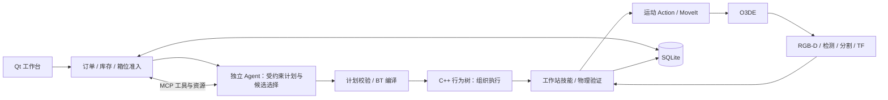

# rai-manipulation-demo · 生鲜配货二次开发分支

基于 [RobotecAI RAI](https://github.com/RobotecAI/rai) 和 [rai-manipulation-demo](https://github.com/RobotecAI/rai-manipulation-demo) 的二次开发。用 O3DE 中的 Panda 机械臂完成有限库存、多订单、**一单一箱**的混合配货。

**仓库定位：保留上游历史的 Fork / 二次开发分支，不是从零编写的独立机器人框架，也不是 RobotecAI 官方版本。** 发布时应先 Fork `RobotecAI/rai-manipulation-demo`，再在自己的 Fork 中发布此分支；不能只创建空仓库便声称 GitHub 已建立 Fork 关系。上游提供仿真与 Panda 操作基础、RAI 工具和感知能力；本分支扩展订单/库存/箱位、调度与 SQLite、独立 Agent/MCP、受约束计划与行为树、运动安全检查及操作界面。许可与素材归属保留原声明。

**当前定位：Ubuntu 24.04 + ROS 2 Jazzy 单机仿真开发版。** 不需要 Docker，不使用网页界面。视觉漏检、遮挡和模拟器原生异常仍有已知限制，不承诺订单必然完成，也没有“五轮压力测试全部通过”的结论。

## 从哪里开始

- **这台电脑已经装过环境：**直接按下面第 1～7 节操作，不要重新下载模型或安装第二套环境。
- **另一台电脑 / 刚克隆仓库：**先读 [首次安装](docs/INSTALL.md)。本仓库不包含 RAI 完整环境、仿真二进制或约 2 GB 的视觉模型缓存。
- **准备发 GitHub：**见 [发布计划与检查](docs/PUBLISH_PLAN.md)。目前仅准备本地文件，不会自动创建仓库或 push。

## 环境与配置（先看这一节）

### 环境组成与本机安装位置

本机使用 **Ubuntu 24.04 + ROS 2 Jazzy + Python 3.12**，模型运行在独立 Conda `rai-jazzy`，界面使用系统 Python/PyQt5，**不需要 Docker**。本机参考硬件为 RTX A4000、16 GB 显存、16 GB 系统内存；这不是最低配置承诺。

| 组件 | 本机位置 | 用途 |
|---|---|---|
| ROS 2 Jazzy / MoveIt 等系统依赖 | `/opt/ros/jazzy` | 节点通信、消息、Action、运动规划和执行 |
| Conda 环境 | `~/miniconda3/envs/rai-jazzy` | PyTorch、GroundingDINO/SAM2、RAI Python 包、MCP/OpenAI SDK |
| PyQt5 | 系统 `/usr/bin/python3` 环境 | 订单界面，避免与模型环境的 Qt 插件冲突 |
| 外层 RAI | `~/rai_embodied_project/src/`、`~/rai_embodied_project/install/` | 视觉服务、仿真桥、接口和启动组件 |
| 本项目 | `~/rai_embodied_project/src/examples/rai-manipulation-demo/` | 工作站、Agent、库存/调度/数据库和 C++ 执行模块 |
| 本项目 ROS 构建结果 | 本项目 `ros2_ws/install/` | ROS 发现本项目节点与自定义接口所需的环境 |
| BehaviorTree.CPP | `~/.local/share/rai-deps/behaviortree-jazzy/prefix/opt/ros/jazzy` | C++ 行为树运行库 |
| O3DE 仿真运行包 | `~/rai_embodied_project/demo_assets/manipulation/RAIManipulationDemo/` | GameLauncher、Cache 与运行库；不能只保留可执行文件 |
| 检测 / 分割权重 | `~/.cache/rai/vision/weights/` | GroundingDINO 与 SAM2 本地权重 |
| BERT 模型与 tokenizer 缓存 | `~/.cache/huggingface/` | 检测模型所需的文本编码资源 |

参考版本：PyTorch 2.3.1、torchvision 0.18.1、transformers 4.57.6、NumPy 1.26.4、rf-groundingdino 0.2.0、rai-gsam2 1.1.3；完整参考与资产指纹见 [runtime-reference.json](environment/runtime-reference.json)。它是本机版本记录，不是跨机器完整锁文件。

启动脚本依次加载 **系统 Jazzy → 外层 RAI overlay → 本项目 overlay**。overlay 就是工作区编译后的环境层，让 ROS 找到对应包和接口。模型进程再激活 Conda，界面仍使用系统 Python。**日常无需自己 source 三遍或激活 Conda**，也不要先叠加 Kilted 等其他发行版环境。

### 启动配置在哪里、怎么改

配置文件是 `~/.config/produce_order_workstation/launch.env`，采用可信 Bash 语法，仅使用自己编写的配置。**这台电脑已经准备好，不要用模板覆盖，否则可能切换到新数据库。** 新电脑才执行：

```bash
mkdir -p "$HOME/.config/produce_order_workstation"
cp config/launch.env.example "$HOME/.config/produce_order_workstation/launch.env"
chmod 600 "$HOME/.config/produce_order_workstation/launch.env"
```

用编辑器修改此文件；主要配置如下：

| 配置项 | 本机值 / 默认与用途 |
|---|---|
| `PRODUCE_RAI_ROOT` | 本机 `$HOME/rai_embodied_project`；外层 RAI 根目录，不是本项目根目录 |
| `PRODUCE_ROS_SETUP` | 默认 `/opt/ros/jazzy/setup.bash` |
| `PRODUCE_CONDA_SH` | 默认 `$HOME/miniconda3/etc/profile.d/conda.sh`；Conda 初始化脚本 |
| `PRODUCE_CONDA_ENV` | 默认 `rai-jazzy` |
| `PRODUCE_BT_PREFIX` | 上表的 BehaviorTree.CPP 前缀；若已装进系统 ROS，可设为空 |
| `PRODUCE_SIMULATOR_BINARY` | 可省略，默认 RAI 根目录下的 `demo_assets/manipulation/RAIManipulationDemo/RAIManipulationDemo.GameLauncher` |
| `PRODUCE_STATE_DB` | 本机明确使用 `~/.local/share/produce_order_workstation/reservation-fix-validation-20261020.sqlite3`；未设置时默认 `workcell-mcp.sqlite3`，**换路径就是换业务历史** |
| `PRODUCE_ROS_DOMAIN_ID` | 本机 `0`；界面、服务及外部 ROS 客户端必须一致 |
| `PRODUCE_READY_TIMEOUT_S` | 默认 `240` 秒；真实就绪等待上限，不是订单执行超时 |
| `PRODUCE_AGENT_MODEL` | 可覆盖项目配置中的模型 Code；必须账户已开通且支持工具调用，不能凭名称推断免费 |
| `PRODUCE_AGENT_BASE_URL` | 可覆盖百炼兼容接口；与账户地区匹配，国内接口示例 `https://dashscope.aliyuncs.com/compatible-mode/v1` |
| `PRODUCE_AGENT_PROXY_URL` | 本机 `http://127.0.0.1:7897`；远程模型代理，不需要代理时设 `""`；ROS/MCP 本机通信不走它 |

例如更换账户可用模型，在外部配置中写：

```bash
PRODUCE_AGENT_MODEL="替换为账户实际开通的模型Code"
# 无需代理时才使用下面这行：
PRODUCE_AGENT_PROXY_URL=""
```

**配置生效规则：**终端显式设置的同名 `PRODUCE_*` 变量优先于配置文件；可用 `PRODUCE_LAUNCH_CONFIG` 指向另一份可信配置。持久修改优先编辑文件，不依赖临时 export。服务运行中改配置不会热更新；先按第 7 节安全处理现场，再运行 `restart`。若只是 `start` 且关键配置与运行实例不同，启动器会提示，不会偷偷切库。

### API Key 与数据必须独立保存

Key 单独放在 `~/.config/rai/bailian.env`，不要写进上面的启动配置或 Git。先创建目录，再用编辑器保存以下格式（占位符替换成自己的密钥）：

```dotenv
DASHSCOPE_API_KEY=YOUR_PRIVATE_KEY
```

```bash
mkdir -p "$HOME/.config/rai"
# 用编辑器创建/编辑 ~/.config/rai/bailian.env 后：
chmod 600 "$HOME/.config/rai/bailian.env"
```

Agent 从私有文件读取 Key；启动器不把 Key 转发进 systemd 可查看的 Environment 字段。不要把真实 Key 放进命令历史、截图或日志。`doctor` 只检查凭据文件存在性和权限，**不证明额度、区域或模型可调用**。

SQLite 与报告保留在 `~/.local/share/produce_order_workstation/`，不属于源码。重启不删库，清空日志不删订单；不要通过删除数据库来绕过恢复确认。

### 新用户配置与下载顺序

以下只用于**还没有环境的新用户**；本机使用者直接进入第 1 节。按现有可运行环境提供步骤，不额外进行新环境安装验证。驱动/CUDA 需与自己的 NVIDIA 显卡匹配；本文不保证不同硬件完全一致。

A～G 尽量在同一终端依次执行；如果中途换终端，先恢复 `RAI_ROOT`、`WORKSTATION` 和外部 BT 前缀变量，再加载 Jazzy。所有路径以自己的安装位置为准。

**A. 准备系统。** 安装 Ubuntu 24.04 图形桌面、NVIDIA 驱动、Miniconda，以及 [ROS 2 Jazzy](https://docs.ros.org/en/jazzy/Installation/Ubuntu-Install-Debs.html)。配置好 ROS apt 源后：

```bash
sudo apt-get update
sudo apt-get install build-essential cmake git git-lfs wget unzip python3-colcon-common-extensions python3-vcstool python3-rosdep python3-pyqt5 ros-jazzy-moveit ros-jazzy-moveit-resources-panda-moveit-config ros-jazzy-depth-image-proc
git lfs install
source /opt/ros/jazzy/setup.bash
```

**B. 获取本 Fork 的发布分支，以及外层 RAI。** 从本 GitHub 页的 Code 按钮复制 **Fork 地址**，分支名使用维护者发布的实际分支，不要下载上游默认分支代替本分支。下面两个占位符发布后应替换为实际值；现阶段尚未创建远程 Fork。

```bash
export RAI_ROOT="$HOME/rai_embodied_project"
export WORKSTATION="$RAI_ROOT/src/examples/rai-manipulation-demo"
git clone https://github.com/RobotecAI/rai.git "$RAI_ROOT"
git -C "$RAI_ROOT" checkout 6802d4073e8caa2ab72c5509fa1eeeb659663f64
mkdir -p "$RAI_ROOT/src/examples"
git clone --branch YOUR_RELEASE_BRANCH https://github.com/YOUR_ACCOUNT/rai-manipulation-demo.git "$WORKSTATION"
git -C "$WORKSTATION" lfs pull
git -C "$RAI_ROOT" apply --check "$WORKSTATION/patches/rai-workcell.patch"
git -C "$RAI_ROOT" apply "$WORKSTATION/patches/rai-workcell.patch"
```

仅在新目录执行，不覆盖现有环境。RAI 补丁是本分支依赖的一部分，不能省略；不需要另 Fork RAI 才能使用本分支。

**C. 补齐 ROS 和行为树依赖。**

```bash
cd "$RAI_ROOT"
vcs import src < ros_deps.repos
# 只有从未初始化 rosdep 的机器才执行 sudo rosdep init
rosdep update
rosdep install --from-paths "$RAI_ROOT/src/src/rai_interfaces" "$RAI_ROOT/src/rai_bringup" "$WORKSTATION/ros2_ws/src" --ignore-src -r -y
```

rosdep 输出有失败项必须处理。BehaviorTree.CPP 本机使用 **4.10.0**，不是 3.x。本机为避免混装发行版，将 Jazzy deb 解包到独立前缀；新机可按同样结构准备：

```bash
sudo apt-get install libsqlite3-dev libzmq3-dev ros-jazzy-tinyxml2-vendor
mkdir -p "$HOME/.local/share/rai-deps/behaviortree-jazzy"
cd "$HOME/.local/share/rai-deps/behaviortree-jazzy"
apt-cache policy ros-jazzy-behaviortree-cpp
apt-get download ros-jazzy-behaviortree-cpp
# 将下面占位符换成上一条实际下载的 deb 文件名：
dpkg-deb -x ./DOWNLOADED_BEHAVIORTREE_JAZZY.deb ./prefix
export PRODUCE_BT_PREFIX="$PWD/prefix/opt/ros/jazzy"
export CMAKE_PREFIX_PATH="$PRODUCE_BT_PREFIX:${CMAKE_PREFIX_PATH:-}"
export LD_LIBRARY_PATH="$PRODUCE_BT_PREFIX/lib:${LD_LIBRARY_PATH:-}"
```

apt 源若不再提供本机相同版本，记录实际版本；不要拿其他 ROS 发行版的包替代。上面的外部前缀随后要写进启动配置。

**D. 创建 Conda 并安装 Python 依赖，然后编译。**

```bash
source "$HOME/miniconda3/etc/profile.d/conda.sh"
conda create -n rai-jazzy python=3.12 pip -y
conda activate rai-jazzy
python -m pip install numpy==1.26.4 torch==2.3.1 torchvision==0.18.1 transformers==4.57.6 scikit-learn==1.3.2 rf-groundingdino==0.2.0 rai-gsam2==1.1.3
python -m pip install -e "$RAI_ROOT/src/rai_core" -e "$RAI_ROOT/src/rai_sim" -e "$RAI_ROOT/src/rai_extensions/rai_perception" -r "$WORKSTATION/requirements/runtime-extra.txt"
conda deactivate
source /opt/ros/jazzy/setup.bash
cd "$RAI_ROOT"
colcon build --symlink-install --packages-select rai_interfaces rai_bringup
source "$RAI_ROOT/install/local_setup.bash"
cd "$WORKSTATION/ros2_ws"
colcon build --symlink-install
source "$WORKSTATION/ros2_ws/install/local_setup.bash"
```

Python 包依赖会联网下载，PyTorch 分发包与驱动需匹配；ROS 构建使用系统 Python，不使用另一 Python 版本替代。编译成功后才继续。

**E. 下载运行资源。** 这些不在源码仓库中；API 模型不需要本地下载。

| 资源 | 下载方式 | 大小与保存位置 |
|---|---|---|
| O3DE Manipulation Jazzy 完整包 | 下方 `download_demo.sh manipulation`，来自 RobotecAI 发布地址 | 大型压缩包；大小以下载显示为准，保留解压完整目录 `RAI_ROOT/demo_assets/manipulation/` |
| GroundingDINO 权重 | `download-perception-models` | 693,997,677 字节，`~/.cache/rai/vision/weights/` |
| SAM2 large 权重 | 同一命令 | 897,952,466 字节，同上 |
| BERT tokenizer 与模型 | 下方 Hugging Face 命令 | 模型约 0.44 GB，加 tokenizer；`~/.cache/huggingface/` |

```bash
cd "$RAI_ROOT"
source /opt/ros/jazzy/setup.bash
bash scripts/download_demo.sh manipulation
source "$HOME/miniconda3/etc/profile.d/conda.sh"
conda activate rai-jazzy
source "$RAI_ROOT/install/local_setup.bash"
download-perception-models
python -c 'from transformers import AutoTokenizer; AutoTokenizer.from_pretrained("bert-base-uncased")'
python -c 'from huggingface_hub import hf_hub_download; hf_hub_download("bert-base-uncased", "model.safetensors")'
```

权重约 2 GB，另计仿真包、源码/LFS、Conda 和 CUDA/PyTorch 下载；**不是只下载 Git 仓库就有完整运行资源**。下载需要可访问对应站点；正式启动离线读取视觉缓存。上游仿真下载脚本会替换已有 manipulation 目录，因此只在首次准备时执行，不要当作日常启动命令。

**F. 写配置。** 按本节上面的模板操作，把 `PRODUCE_RAI_ROOT`、Conda、BT 前缀和新数据库路径填好；新用户不使用本机历史验证库。独立保存自己的 Key，选择已开通的工具调用模型，代理仅按实际需要填写。不要照抄本机 `7897` 代理。

**G. 启动并看效果。** 在已登录桌面的终端：

```bash
cd "$WORKSTATION"
bash start.sh doctor
bash start.sh start
```

doctor 通过后启动；等待 READY，看到仿真、订单窗口和桌面物品，再按第 3 节填写一份混合订单。具体环境细节另见 [安装说明](docs/INSTALL.md)。本流程按现有环境整理，未额外执行新环境安装验证。

## 1. 启动前：先检查，不要重复点启动

本机在**已登录图形桌面的终端**运行，路径不依赖终端当前所在目录：

```bash
bash "$HOME/rai_embodied_project/src/examples/rai-manipulation-demo/start.sh" doctor
```

或者进入自己实际克隆的项目根目录，后续统一使用：

```bash
bash start.sh doctor
```

`doctor` 检查 Jazzy、两个构建 overlay、Conda SDK、Qt、动态库、仿真资源、视觉缓存和私有 Key 文件，不启动仿真、不提交订单、不调用计费模型 API。看到 `[FAIL]` 就按该行提示处理，不要继续启动。

机器配置放在 `~/.config/produce_order_workstation/launch.env`，模板是 [config/launch.env.example](config/launch.env.example)。本机已准备此文件，并保留现有业务数据库；**doctor 输出的 PRODUCE_STATE_DB 才是本次选择的数据库**，不要假设它总是默认库。

## 2. 启动整个项目

```bash
bash start.sh start
```

本机从任意目录可直接运行：

```bash
bash "$HOME/rai_embodied_project/src/examples/rai-manipulation-demo/start.sh" start
```

脚本自动准备环境，启动 O3DE、MoveIt、视觉服务、独立 Agent、C++ 行为树、订单服务和 Qt 工作台；不要求在终端提前激活 Conda。

**不要同时再手动启动 GameLauncher、MoveIt 或 order_server。** 重复 `start` 不会创建第二套。后台启动后关闭启动终端不会停止项目。

启动命令最多等待 240 秒，期间会打印业务状态；它不再只凭 `systemd active` 就说成功：

| 结果 | 意味着什么 | 下一步 |
|---|---|---|
| `[就绪]`，界面为“就绪” | 时钟、关键 Action、视觉服务和工作台状态有效 | 开始第 3 节 |
| INITIALIZING / SCANNING | 正在加载或进行初始化视觉验收 | 等待，不重复启动/提交 |
| `[需处理]`，退出码 2 | 服务上线，但业务要求恢复或库存处理 | 按第 5 节，不当作启动程序崩溃 |
| `[未就绪]`，退出码 1 | 超过等待上限，或关键接口/时钟没有准备好 | 运行 `logs-once` 查看原因；后台不会因超时被强制删除 |

**窗口出现 ≠ 库存通过；就绪 ≠ 模型账户有额度。** Agent 在接单后才真正调用模型，doctor 不会消耗额度验证。

## 3. 完成第一份订单

1. 看顶部工作台状态，等待“就绪”。桌面初始预置混合商品；空闲箱位不代表已经有四个空箱。
2. 在“新建订单”填写数量。不需要的商品填 **0**；当前每单合计上限 **8 件**，不是每类都可以各填 8。
3. 保留自动生成的唯一订单号，选择优先级（数值越大越优先），点击 **提交订单** 一次。
4. 查看“已登记”回执和当前订单队列。**已登记不等于立即执行**：库存/箱位不足会等待；正在执行另一单时，新订单仍可登记。
5. 执行时观察最近任务、商品进度和箱位。Agent 选择受约束计划及视觉候选，行为树组织执行，MoveIt 规划机械臂运动。
6. 显示“等待取货”后，在“订单箱位”下方的下拉框选择对应订单，点击 **确认取货**。仿真会移走该订单的箱子和商品，释放箱位；不要在尚未完成时把它当作强制清理按钮。
7. 等待取货后的库存复查结束，再继续操作。遇到“工作台忙”看状态等待，不连续点击。

同一订单的玉米、胡萝卜、苹果、番茄放入**同一个订单箱**。完成配货不自动移走箱子，也不自动重建整个桌面。

## 4. 连续订单、库存和常用按键

队列显示当前任务，不混排普通历史已结束记录；历史到“订单记录”查看。执行任务置顶，等待任务按优先级降序、同级按登记序号先来先服务。缺货/缺箱可跳过等待，**等待顺位不是无条件执行顺序**，也不会在夹着商品时切换订单。

| 按键 / 区域 | 什么时候用 | 结果与注意事项 |
|---|---|---|
| 提交订单 | 数量合法、服务同步时 | 登记需求，观察回执；不要重复创建相同需求 |
| 换订单号 | 准备另一份新需求时 | 只更换草稿编号，不重试失败订单、不取消旧单 |
| 最近任务 → 取消 | 当前订单执行中 | 请求安全取消，等待结果；不是急停，不能推断机械臂立即停止 |
| 取消选中排队单 | 先选中未执行等待单 | 只取消这单；选中安全暂停单时文字变为“丢弃暂停订单…”并要求确认 |
| 清除待执行队列 | 不再需要等待中的需求 | 保留执行中、已部分装箱和待取货订单，不清空数据库 |
| 视觉复查 | 观测不足、暂停后需要重新确认 | 保留原需求和进度，重新检查可用观测；不是生成商品 |
| 补货准备 | 确认需要补货，且工作台空闲、按钮可用 | 替换桌面剩余货源，保留订单箱和已装进度；之后等待视觉复查 |
| 确认取货 | 订单真正 WAITING_PICKUP | 移走对应箱与商品，释放箱位 |
| 清空日志 | 只想清理显示内容 | 不修复故障、不停止任务、不清除数据库审计 |
| 清除已结束记录 / 恢复显示 | 整理历史界面 | 隐藏/恢复显示，不删除业务真相；活动资源受保护 |
| 诊断与帮助 | 状态异常，不清楚下一步 | 检查相机数据、处理指南、技术日志、恢复/重置入口 |
| 业务协作 → 查状态 | 想查看业务事实，不想调用模型 | 直接查询真实状态；“询问 Agent”才会调用模型 |

**这里没有“暂停全部调度”按钮。** 关闭测试脚本或关闭 Qt 都不等于停止后台工作站；已登记订单仍可能被调度。确实要停机按第 7 节，不用清空日志代替停止。

## 5. 出问题时，按状态处理

| 现象 / 状态 | 推荐的操作顺序 | 不应该做什么 |
|---|---|---|
| 等待库存 / No selectable ... | 诊断与帮助 → 检查相机数据 → 视觉复查；确认实际缺货后再补货准备 | 不把漏检直接等同缺货，不重复下单 |
| 库存复查失败 / 超时 | 先检查三路相机消息；有消息再复查；仍失败查看技术日志 | 不连续补货掩盖相机或模型服务故障 |
| 等待箱位 | 选择已完成订单 → 确认取货 → 等待释放 | 不取消已装好的订单来制造空箱 |
| 暂停、已有装箱进度 | 核对现场 → 视觉复查，等待原单重新准入；确实放弃才选中它并确认丢弃 | 不重新提交完整数量，否则可能形成两单 |
| 本单 FAILED，但工作台就绪 | 看订单原因与技术日志；排除原因后，如需重做用新订单号 | FAILED 不会自动变成功；不要无条件重复机械动作 |
| 需要恢复 / 运动结果未知 | 先核对夹爪与箱；处理待取货/安全暂停单；再用恢复入口并阅读清理确认 | 不把取消、超时当“没有发生运动”的证据 |
| 重启后提示历史现场待核对 | 按下面的“重启现场核对”完整流程 | 不删除数据库来绕过历史任务 |
| 模型 HTTP 401/403/429、额度不可用 | 核对账户、地区、型号和额度；修改外部模型配置后安全重启 | 复查/补货按钮不能解决 API 鉴权和额度问题 |
| 服务离线、仿真已退出 | `bash start.sh logs-once` → 记录错误 → 安全重启；有旧任务按核对流程 | 不在后台失联时反复提交 |
| 按键灰色 | 检查状态是否同步、是否选中订单、是否正扫描/执行、是否满足安全条件 | 灰色不是让你从终端绕过检查 |

### 重启现场核对：需要确认的地方在哪里？

1. 先等待启动阶段的自动检查点恢复。恢复成功会继续显示原订单进度；**不要立即又提交相同需求**。
2. 如果仍显示“历史现场待核对 / 需要恢复”，在底部 **业务协作** 页签点击 **现场核对…**。
3. 请求列表出现“核对并重建旧现场”后，**选中这一行**，再点击列表下方 **确认**。
4. 阅读弹窗，确实同意丢弃未核对旧现场并重建，才点击 **Yes / 是**。只点“现场核对…”不会直接重置；只输入“确认”文本也不等于批准。
5. 等待请求状态变为“执行中 → 已完成”，工作台重新扫描并就绪。如果显示“未启动，可重试”，先处理提示的忙状态或安全条件，再选中请求确认。

重建会清理旧物理现场；旧订单保留历史但不算交付。普通运行中的失败恢复，使用“最近任务”的 **恢复工作台…** 或“诊断与帮助 → 恢复 / 重置工作台…”，同样须先处理保留资源。**恢复是破坏现场的维护，不是无损重试。**

## 6. 窗口、状态与日志

```bash
bash start.sh panel       # 仅重开订单界面；不会重复启动整个仿真
bash start.sh status      # 系统服务状态 + 有上限的 ROS 健康检查
bash start.sh ready       # 只检查业务/通信就绪，不下单
bash start.sh logs-once   # 最近日志，打印后退出
bash start.sh logs        # 持续看日志；Ctrl+C 只退出看日志
```

`panel` 打开后仍离线，说明不是“再开一次窗口”就能修复后台。启动配置或代码更新后，`start` 不会替换已经运行的进程，需要安全 `restart` 才加载新配置。

本地数据：

- 启动配置：`~/.config/produce_order_workstation/launch.env`。
- API Key：`~/.config/rai/bailian.env`，权限 600，不显示、不提交。
- 订单数据库：以 doctor 的 `PRODUCE_STATE_DB` 为准，默认 `~/.local/share/produce_order_workstation/workcell-mcp.sqlite3`；本机可能明确选择历史验证库。
- 订单报告与感知诊断：`~/.local/share/produce_order_workstation/reports/`、`perception/`。
- 进程日志：用户级 journal；数据库记录才是业务依据，清空界面显示不会删库。

## 7. 正常停机与重启

先不要再提交新单，取消不需要的未执行排队单；如有当前动作，点击“取消”并等待安全结果。已完成订单先确认取货；暂停或状态不明订单先核对。

```bash
bash start.sh stop
bash start.sh start
# 或安全处理现场后：
bash start.sh restart
```

`stop` 停止工作站、界面及相关测试控制器，**不删除数据库，也不把未完成订单当成完成**。紧急关闭仿真/进程可能留下待核对状态，下一次必须走恢复流程。

## 8. 模块与源码学习



Agent 不直接生成关节轨迹或自行确认装箱；行为树不代替库存账本；MoveIt 不理解订单。

- 业务与持久化：`ros2_ws/src/produce_order_workstation/produce_order_workstation/`。
- 自定义 ROS 接口：`ros2_ws/src/produce_order_interfaces/`。
- 行为树执行：`ros2_ws/src/produce_order_bt/`。
- 机械运动：`ros2_ws/src/robotic_manipulation/`。
- 仿真素材：`Project/`；RAI 外部兼容修改：[patches/README.md](patches/README.md)。
- 学习与阶段边界：[阶段评估](docs/PROJECT_CHECKPOINT_AND_QUEUE_FIX_2026-10-21.md)。旧 docs 包含历史方案，涉及已重构对象时以当前源码为准。

## 许可与验证范围

保留上游 Apache-2.0 [LICENSE.txt](LICENSE.txt) 及素材 NOTICE；本项目不是将上游框架全部声明为原创。模拟器和模型从其原始渠道准备，不放进 Git。

最后一批固定压力测试只完成前三轮完整核验，第四轮因玉米候选不可选退出；不能把后续数据库数量增加算成五轮通过。原生崩溃根因仍开放。轻量 CI 仅验证脚本/审计/启动器契约，**不代表真实 ROS 仿真端到端验收**。
