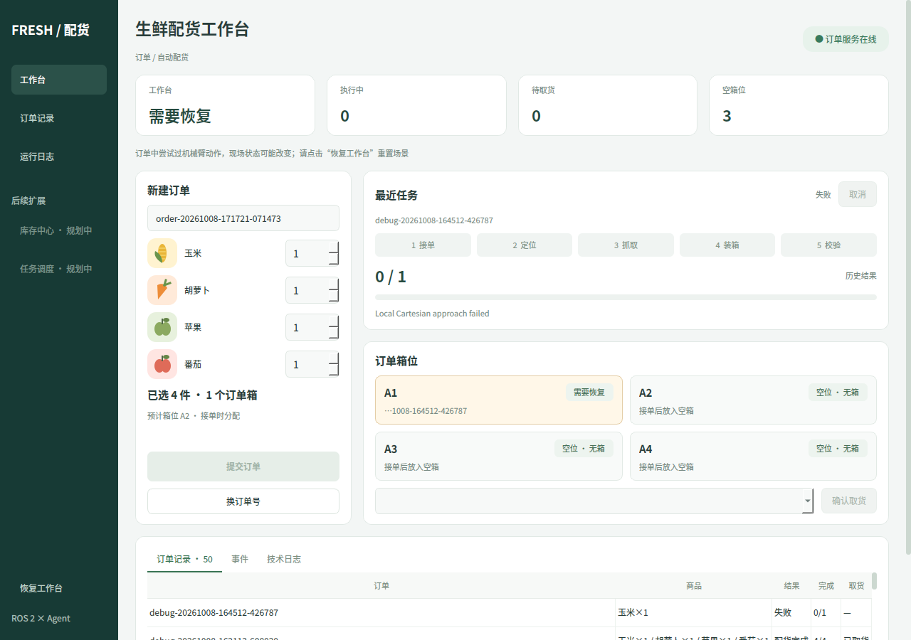

# Robotic Arm Manipulation Demo

## 本地配货工作台

本机一键启动与停止见 [启动说明](启动说明.md)，入口为项目根目录的 `start.sh`。

2026-10-13：在常驻Agent/MCP边界上加入业务协作、C++行为树、SQLite保守恢复。当前架构、运行入口、验证结果和限制见 [第4～7步实施说明](docs/PHASE47_MCP_DELIVERY.md)。

原生 Qt 订单界面已重构为下单、任务进度、箱位与记录四个区域。设计与模块说明见 [界面重构记录](docs/ORDER_UI_REDESIGN.md)。未实现的扩展页面明确标为规划中。

新增 [接近运动碰撞修复与实测记录](docs/CARTESIAN_APPROACH_FIX.md) 和 [视觉候选库存台账模块说明](docs/VISUAL_INVENTORY_LEDGER.md)。侧栏“视觉库存”显示观测、单件预留与搬运状态，不代表已经清点确认的实际库存。

机械臂姿态与路线优选、降速设置见 [轨迹优化说明](docs/MOTION_PREFERENCES.md)。

后续针对实测关节大幅摆动的优化、失败迭代与复测记录见 [关节摆幅排查（旧布局）](docs/JOINT_EXCURSION_FIX.md)。

经用户允许调整库存分布后的实测改善、初始化布局检查及保留的限制见 [备货工作区调整](docs/STOCK_WORKSPACE_LAYOUT.md)。



This project demonstrates the use of [RAI](https://github.com/RobotecAI/rai) framework interfacing with a robotic arm in a simulation. In particular, it shows the communication between Generative AI models and the [Panda Franka](https://www.franka.de/) manipulator, which is a popular choice in AI and manipulation research in the robotic community. 

The simulation uses [O3DE](https://www.o3de.org/) game engine paired with [ROS 2 Gem](https://docs.o3de.org/docs/user-guide/interactivity/robotics/).


## Demo description

The demonstration features a simulation of a robotic arm equipped with a gripper, which interacts with a multitude of objects that can be grasped, sorted, or manipulated based on instructions issued in the natural language. The RAI framework captures contextual information such as camera images and available command sets, subsequently translating these commands into ROS 2 messages to execute the arm's movements resolved by the Generative AI models.

# Building the demo

## Prerequisites
- Install [ROS2](https://docs.ros.org/en/jazzy/Installation/Ubuntu-Install-Debs.html)
- Install all ROS2 packages [required by O3DE](https://docs.o3de.org/docs/user-guide/interactivity/robotics/project-configuration/)
- Install the packages required by this project:
```bash
rosdep install --from-paths ros2_ws/src --ignore-src -r -y
```
- Install `git-lfs` for pulling binary files:
```bash
sudo apt-get install git-lfs
```
- Clone and build [RAI](https://github.com/RobotecAI/rai?tab=readme-ov-file#setup) (follow the instructions there).

## O3DE Setup

Assuming a common base folder `$DEMO_BASE` (absolute path):
1. Clone O3DE and register the engine:
```bash
cd $DEMO_BASE
git clone https://github.com/o3de/o3de.git -b main
cd $DEMO_BASE/o3de
git lfs install
git lfs pull
python/get_python.sh
scripts/o3de.sh register --this-engine
```

2. Clone o3de-extras and register the gems
```bash
cd $DEMO_BASE
git clone https://github.com/o3de/o3de-extras.git -b main
$DEMO_BASE/o3de/scripts/o3de.sh register -agp $DEMO_BASE/o3de-extras/Gems
```

## Project setup

1. Clone the repository and build the O3DE project.

```bash
cd $DEMO_BASE
git clone https://github.com/RobotecAI/rai-manipulation-demo
cd $DEMO_BASE/rai-manipulation-demo/Project
cmake -B build/linux -G "Ninja Multi-Config" -DLY_STRIP_DEBUG_SYMBOLS=TRUE -DLY_DISABLE_TEST_MODULES=ON
cmake --build build/linux --config profile --target RAIManipulationDemo.Assets RAIManipulationDemo.GameLauncher Editor
```

2. Build the ROS2 workspace.

> ****NOTE****: This step requires to have [RAI](https://github.com/RobotecAI/rai) packages built and sourced! Make sure to run `source install/setup.sh` in the RAI directory before continuing.

```bash
cd $DEMO_BASE/rai-manipulation-demo/ros2_ws
colcon build
```

## Running the demo

1. Run the Game Launcher.
```bash
cd $DEMO_BASE/rai-manipulation-demo/Project
./build/linux/bin/profile/RAIManipulationDemo.GameLauncher
```

2. Launch MoveIt:

```bash
cd $DEMO_BASE/rai-manipulation-demo/Project/Examples
ros2 launch panda_moveit_config_demo.launch.py
```

3. Run the manipulation interface node.

```bash
cd $DEMO_BASE/rai-manipulation-demo
source ros2_ws/install/setup.bash
ros2 run robotic_manipulation robotic_manipulation
```

The package exposes one service:

- `/manipulator_move_to` ([rai_interfaces/srv/ManipulatorMoveTo](https://github.com/RobotecAI/rai/blob/development/src/rai_interfaces/srv/ManipulatorMoveTo.srv)) -
Moves the manipulator to the specified pose, with two intermediate poses above the current position and the target pose, allowing safe manipulation of the objects on the scene. Allows specifying gripper states before and after the movement.
