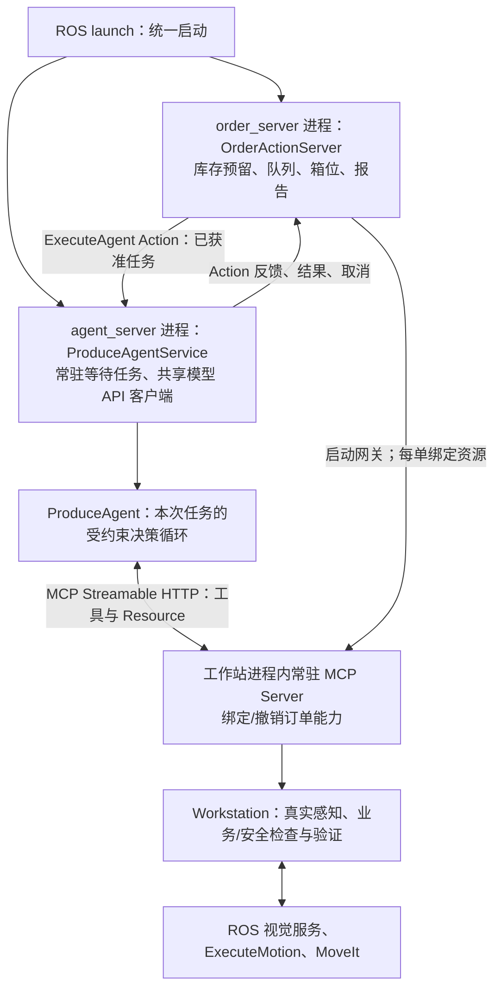

# 常驻 Agent 服务与任务执行（2026-10-12）

## 当前运行方式

项目 launch 同时启动 `agent_server` 和 `order_server`，前者创建独立进程的
`ProduceAgentService` ROS 节点，后者创建工作站与常驻 MCP HTTP 网关。
Agent 服务启动时只创建模型 API 客户端和 ROS 接口，没有订单时不调用模型。
任务到达时才建立当前订单的 MCP 客户端会话，并创建单任务 ProduceAgent。
因此“服务一直在线”和“每份订单有独立执行器/对话”同时成立。



## 模块、对象与上下游

源码在 `ros2_ws/src/produce_order_workstation/produce_order_workstation/`。

| 文件/对象 | 输入 | 输出与职责 |
|---|---|---|
| `order_server.py` / OrderActionServer | SubmitOrder、取货/取消/复查请求 | 调度获准订单；启动一次常驻 MCP 网关；资源互斥与报告照旧 |
| `runtime.py` / Workstation.run | 当前获准订单 | 绑定 MCP 订单会话，调用 AgentDispatcher；不创建或导入 ProduceAgent，不访问模型 |
| `agent_dispatch.py` / AgentDispatcher | 订单、MCP 地址/临时能力 | ROS ExecuteAgent Goal；接收反馈转入原有事件链；传递取消、解释结果与超时 |
| `agent_service.py` / ProduceAgentService | ROS ExecuteAgent Goal | 验证任务与本机地址、拒绝并发；创建单任务 MCP Client 和 ProduceAgent；反馈与终态 |
| `agent.py` / ProduceAgent | 订单、配置、工具客户端、模型、日志/取消回调 | 单任务对话、工具选择、执行反馈、预算与退出条件；无 Workstation 依赖 |
| `mcp_server.py` / WorkstationMCPServer | 当前订单作用域内的 MCP 请求 | 常驻 HTTP；库存/感知/运动能力转发；拒绝未绑定或过期能力 |

### ProduceAgentService

- `model`：项目启动时初始化的模型 API 客户端，任务之间复用；不是本地权重。
- `_busy`、`_lock`：互斥接收；一个机械臂不能同时被两个 Agent 任务操作。
- `_active_order`：当前任务编号；任务结束后清空。
- `_stopping`：退出信号；阻止新的任务并停止后续决策。
- `_model_error`：启动时模型客户端不可用的原因；不隐藏为“就绪”。
- `accept()`：校验订单和本机 MCP 地址，检查忙碌/停止/模型可用状态。
- `execute()`：连接 MCP，核对 Resource 中的订单编号、区域、商品数量，再启动
  ProduceAgent；将取消、暂停、失败、成功分别映射为 Action 结果。
- `publish_status()`：发布 IDLE/BUSY/MODEL_UNAVAILABLE 与错误信息。
- `main()`：ROS launch 执行入口，创建节点并启动多线程 ROS Executor。

### AgentDispatcher

- `client`：`/produce_agent/execute` 的 ROS Action 客户端，不包含模型逻辑。
- `state` / `error`：订阅常驻服务状态；缺服务、忙碌或模型不可用时暂停新调度，
  保持订单排队，不提前占库存和箱子。队列中显示排队原因。
- `execute()`：发 Goal、转发反馈、等待结果，取消只请求一次；不自动重发任务。
- 服务失联/超时不能证明机械臂停止：MCP 会话撤销前排空物理调用，现有工作站
  的暂停/恢复规则决定后续是否需要人工核对。

## ROS 与 MCP 接口

| 接口 | 类型 | 作用 |
|---|---|---|
| `/produce_orders/submit` | 原有 Service | 登记订单；登记不等于执行完成 |
| `/produce_orders/execute` | 原有 ExecuteOrder Action | 外层订单执行、队列反馈与报告，保持面板兼容 |
| `/produce_agent/execute` | 新 ExecuteAgent Action | 订单层把获准任务交给独立 Agent 服务 |
| `/produce_agent/status` | String Topic，Transient Local | IDLE/BUSY/MODEL_UNAVAILABLE、当前订单和错误 |
| `/produce_orders/execute_motion` | 原有 ExecuteMotion Action | 一段机器人运动，MoveIt 规划/执行不变 |
| 本机 HTTP `/mcp` | MCP Streamable HTTP | 三工具与只读订单 Resource；非 ROS 话题 |

`ExecuteAgent` Goal 包含 order_id、zone、lines、mcp_url、mcp_token；Result 为
status/error；Feedback 为 stage/detail_json。能力凭据由订单宿主提供，不交给模型，
不写日志。ROS Action 数据本身未增加加密，因此本版本只适合可信本机 DDS 域，
不是公网多租户授权方案。

MCP Resource 现在还包含 zone/requested，服务端每次真正执行前再次核验请求能力。
`ContextVar` 将 HTTP 请求认证的能力传到工作线程，避免“旧请求已认证，但排队
到执行时已切到新订单”的跨订单竞态。旧能力即使通过先前的 HTTP 检查，也不能
执行新订单的工具。

## 一份订单从接收到结束

1. 面板/CLI 登记订单，订单管理器检查库存和箱位；Agent 服务无需为登记而重启。
2. 调度器检查 Agent 服务可用性，选择订单，发送原有 ExecuteOrder Action。
3. 外层回调准备/恢复资源，Workstation.run 在已启动的网关上绑定订单，生成新能力。
4. AgentDispatcher 发送 ExecuteAgent Goal，常驻 Agent 服务检查接收资格。
5. 服务连接本单 MCP 会话，核对完整订单，创建独立 ProduceAgent；模型选择工具。
6. MCP 服务调用工作站能力，工作站继续通过 ROS 视觉与运动 Action 执行和验证。
7. Agent 事件经 ExecuteAgent Feedback 回到工作站，再进入原有订单反馈/技术日志。
8. Agent 关闭本单客户端并返回结果；服务仍在线、模型客户端仍可复用。
9. 宿主排空网关调用、撤销本单能力；保留装箱现场，生成原有报告与等待取货状态。

无任务时 MCP 网关不绑定订单，不允许抓取；收到新订单后不会复用上一单对话。
暂停后重调度仍使用新的单任务上下文，已验证计数来自工作站 Resource。

## 启动、检查与 CLI

启动命令不变：

```bash
bash /home/wang/rai_embodied_project/src/examples/rai-manipulation-demo/ros2_ws/src/produce_order_workstation/scripts/start_workstation.sh
bash /home/wang/rai_embodied_project/src/examples/rai-manipulation-demo/ros2_ws/src/produce_order_workstation/scripts/start_debug_panel.sh
```

不需要手动再开一个 Agent，否则会出现相同 Action 的重复服务端。
在加载同一套 Jazzy/工作空间的终端可检查：

```bash
ros2 node list
ros2 action info /produce_agent/execute
ros2 topic echo /produce_agent/status --once
```

启动日志出现“Agent runtime online; waiting for admitted tasks”是服务在线。
IDLE 表示没有任务，不代表已验证 API 额度；额度/网络错误仍需任务实际调用才发现。

旧 `run_order` 非 dry-run 分支改为向常驻订单服务 SubmitOrder 登记，不再创建另一
工作站或重置场景。`--prepare-scene`/`--scene` 为旧参数，场景由服务管理。
它返回 REGISTERED/REJECTED 受理结果；`--report` 保存的是受理回执，最终执行报告
仍由订单服务保存。`--dry-run` 保持纯本地校验，不发 ROS 或模型请求。

## 验证与边界

- MCP/Agent 单元检查：空闲网关拒绝执行、订单能力轮换、旧请求跨单拒绝、订单
  上下文匹配、忙碌拒绝、错误/暂停/取消结果、日志不包含能力凭据。
- DDS 71 隔离集成：真实独立 Agent 子进程、真实 ExecuteAgent/ExecuteMotion
  Action、真实 MCP HTTP；同一 Agent 进程处理两份订单各四次运动。
- 用共享计数器证明服务先在线且模型调用为零；随后两单共六次模型选择；模型
  暂停期间第二个任务被拒绝，取消通过真实 Action 生效，迟到选择不执行运动。
- 模型、视觉结果和运动执行器是替身，不调用收费 API、不触及用户订单或仿真物体。
- 保留第 4～7 步 stash/备份；本次没有恢复行为树或 SQLite 改动。
- 原有 MoveIt 同步执行和 API 请求不可即时打断的局限保留。取消不是急停，常驻
  进程不意味着持久化或进程崩溃后自动恢复物理动作。

### 本次实际检查结果

- 非 GUI 工作站测试：200 项通过，2 项隔离 ROS 测试在普通运行中按条件跳过。
- 系统 Python / PyQt5：46 项通过。
- 在 DDS 71 显式运行两个 ROS 集成测试：2 项通过；其中一个启动独立 Agent
  子进程，验证常驻待机、连续两单、忙碌拒绝和实际 Action 取消。
- 接口包与工作站包构建成功；新增启动脚本 shell 语法检查通过。
- DDS 172 中实际执行 `ros2 run produce_order_workstation agent_server`，读到
  `{"state":"IDLE","order_id":"","error":""}`，Action 查询显示一个
  `/produce_agent_service` 服务端。没有下订单或调用模型，检查后已停止该临时服务。
- 没有启动用户仿真或提交用户订单，也没有宣称真实视觉与机械臂装箱验收完成。
