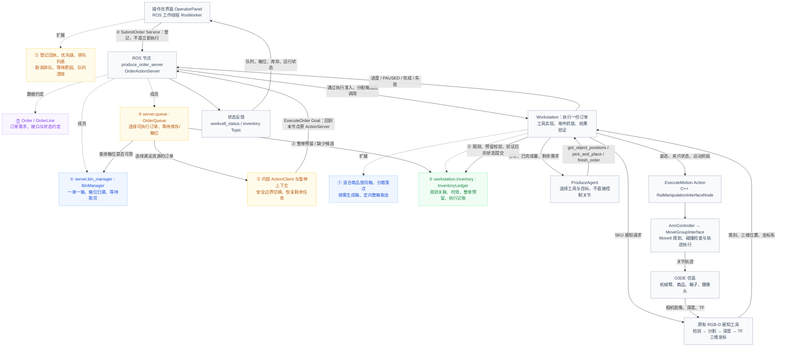

# 原有架构与第 0～3 步改动：按业务链理解

本文描述当前代码，不把后续规划当成已经实现的功能。四步指第 0、1、2、3 步。
颜色：紫色＝第 0 步接口与对象；蓝色＝第 1 步订单箱；绿色＝第 2 步库存；橙色＝第 3 步队列调度。灰黑文字＝保留的执行能力。

## 1. 整体框架图

实线表示请求、调用或执行结果；虚线“成员/扩展”表示对象归属，不是 ROS 通信。
图中的队列、箱位管理器、库存账本、Agent 都不是新增独立 ROS 节点。

**读图顺序：上半部分决定“哪个订单可以执行”，下半部分完成“这一件商品怎样搬过去”；结果回流后，库存、订单和箱位一起更新。**

第 0、1 步建立订单与箱子的关系；第 2 步建立商品与订单的关系；第 3 步让多份订单根据这些资源关系排队执行。不是把机械臂运动重新实现三遍。

## 2. 先对比：究竟增加了什么

| 问题 | 第 0、1 步解决到哪里 | 第 2、3 步进一步解决什么 |
| --- | --- | --- |
| 一份混合订单装到哪里 | 分配一个订单箱，按规则分散放置 | 多单各自占有箱位，无空位就等待 |
| 哪些商品可以抓 | 单件执行时定位、检查和验证 | 持续候选账本，执行前整单预留，避免重复承诺 |
| 机械臂忙时提交新单 | 原执行 Action 不能并行启动另一单 | 新 Service 先登记，等待调度，不并行运动 |
| 下一单是谁 | 没有完整业务队列负责选单 | 根据优先级、登记顺序、库存和箱位选单 |
| 急单如何插入 | 不能在运动中直接抢控制权 | 当前商品装好且机械臂退出后，安全暂停并切换 |
| 一单完成后 | 箱子保留，确认取货才释放 | 队列更新为待取货，其他订单仍不能复用该箱 |

## 3. 模块 A：输入与反馈——OperatorPanel / RosWorker

代码：`ros2_ws/src/produce_order_workstation/produce_order_workstation/operator_panel.py`、`debug_panel.py`。

**整体作用：**把操作员意图变成结构化 ROS 请求，把服务端的真实状态变成界面反馈。界面不是调度器。

- 上游：操作员填写订单号、SKU 数量、区域、优先级，点击提交、取消、取货或复查。
- 对象：`OperatorPanel(QWidget)` 负责控件与显示；`RosWorker(QThread)` 中的 ROS 节点、客户端和订阅负责通信。两者通过信号等机制交接，不能让耗时 ROS 等待堵住界面线程。
- 输出到下游：`SubmitOrder` 请求交给订单服务；取消排队请求携带明确订单号；取货请求也携带订单号，不能只写“清空箱子”。
- 输入自下游：登记响应、工作台状态 Topic、库存 Topic，以及执行反馈/结果。

第 1 步让界面理解“空箱位、订单箱、待取货”。第 2 步显示库存的状态、归属和时效。第 3 步增加优先级、排队单、等待原因与取消入口；后续补充了持续可见的队列和独立登记回执。

**三个状态必须区分：**“我点了提交”只是用户动作；`success=true` 表示服务登记成功；列表进入执行中才说明调度已启动执行。新订单草稿不能覆盖当前正在执行的订单。

取消未开始的排队单会释放其未搬运预留；取消执行中订单需要走执行取消通路。已经部分装箱的暂停单不能按普通排队单随意删除。清除日志和清除历史显示也不等于删除业务资源或审计报告。

## 4. 模块 B：业务入口与执行准入——OrderActionServer

代码：`ros2_ws/src/produce_order_workstation/produce_order_workstation/order_server.py`。

**节点是 `produce_order_server`，类是 `OrderActionServer`。这是业务通信中枢，而不是关节控制器。**

它持有以下重要对象或成员：

| 成员 | 用途 | 与谁交互 |
| --- | --- | --- |
| `queue` | 多订单记录与选单规则 | `OrderQueue` |
| `bin_manager` | 箱位占用和订单绑定 | `BinManager` |
| `workstation` | 运行当前订单及实际工具 | `Workstation` |
| `_dispatch_client` | 把选中的订单送入原执行 Action | 本节点的 `ExecuteOrder` ActionServer |
| `_dispatch_order_id` / `_dispatch_handle` | 当前调度请求及取消句柄 | Action 反馈、结果与取消回调 |
| `_order_contexts` | 安全暂停的已完成量、已装实体、事件等 | Workstation 恢复执行 |
| `_busy` | 执行、扫描或场景维护的互斥状态 | 准入和维护回调 |
| `_scene_ready` / `_inventory_ready` | 现场可执行、库存扫描是否可用 | 调度入口；不等于视觉分类绝对正确 |
| `_scan_requested` | 记录复查需求，空闲后再扫描 | 维护线程与调度定时器 |
| `_lock` | 保护业务状态修改，避免回调争抢 | 登记、调度、执行、取货等回调 |

### 输入经过这里怎样往下走

1. `submit_callback()`：收到 Service 请求，校验订单，调用 `queue.submit()`。返回“已登记”，此时不执行抓取，也不自动放箱。
2. `dispatch_pending()`：定时检查是否空闲、现场是否可执行、是否需要先扫描库存，再调用 `queue.select()`。
3. 选单成功后，通过 `_dispatch_client.send_goal_async()` 发出 `ExecuteOrder` Goal。
4. `goal_callback()`：原 ActionServer 再检查登记需求是否一致、整单预留、忙状态、箱位条件；通过后分配/复用箱位并接受执行。
5. `execute_callback()`：把订单及箱位交给 Workstation，必要时恢复暂停上下文，再执行。
6. 进度更新队列；结果回调更新业务状态并释放当前执行占用。失败且物理状态不明时，进入恢复状态，而不是直接开始下一次抓取。

**为何同一节点既有 ActionClient 又有 ActionServer？** 新调度模块是客户端，原执行模块是服务端；它们共用原执行协议，避免队列另写一条绕过准入、取消和反馈的执行路径。同一进程内部也可以通过 ROS Action 通信，不代表增加了第二台机械臂。

输出有两路：向下是订单执行；向上是状态 Topic、Service 响应和 Action 反馈/结果。Watchdog 监测请求接受、反馈和总执行超时；结果不明时隔离执行状态，不把超时误认为“机械臂肯定没动”。

## 5. 模块 C：订单箱资源——BinManager 与 Workstation 的箱子操作

代码：`fulfillment.py`、`order.py`、`runtime.py`，均在上述 Python 包目录内。

**整体作用：**把“订单归属的逻辑箱位”和“仿真中真实存在的箱子”协调起来。这主要对应第 0、1 步，第 3 步开始让它参与多单资源调度。

- 对象：`server.bin_manager` 是 `BinManager`，其 `bins` 保存 `BinResource`，`orders` 保存 `OrderAllocation`。
- `BinResource`：`bin_id`、`zone`、`index`、`state`、`order_id`，说明某个箱位是否空闲及归属。
- `OrderAllocation`：`order`、`bin_indices`、`state`、`entities`，说明某单占哪一个箱位，以及经执行验证记录的商品。
- 上游：调度器查询空位；Action 准入要求分配；执行结果要求改变箱位状态；操作员请求取货。
- 输出：箱位索引和订单绑定交给 Workstation；箱位状态交给界面和调度器。

主要功能：`can_allocate()` 查询；`allocate()` 分配；`finish()` 按完成、暂停、失败更新状态；`pickup()` 检查是否允许取货；`confirm_pickup()` 在物理清理成功后释放；`discard_paused()` 处理明确确认的部分单丢弃；`snapshot()` 发布状态。

Workstation 的对应物理操作：

- `ensure_order_bins()`：只生成已分配的订单箱，并同步 MoveIt 场景。
- `begin_order()`：记录本次箱位，准备本单计数与临时执行状态。
- `plan_placements()`：根据本单商品数量产生分散的落点，同一订单不同 SKU 进入同一箱。
- `collect_order()`：验证并定向移走该单商品和整个箱子，再更新库存取货状态。

顺序为：**选择空箱位 → 分配归属 → 生成真实箱子 → 抓放 → 待取货 → 确认整箱移走成功 → 释放箱位。**
默认配货模式初始 A1～A4 是四个位置，不是四只已生成的收货箱。图中的侧放周转箱障碍物是另一种现场物体。

## 6. 模块 D：持续库存——InventoryLedger

代码：`inventory.py`；调用它的执行方法在 `runtime.py`。

**整体作用：**将“视觉刚看到的候选”和“业务已经承诺/搬运的资源”关联起来。它不是另一个检测模型，也不是独立 ROS 节点；实际对象是 `server.workstation.inventory`。

### 上游输入与内部数据

输入来自 Workstation 调用 RGB-D 工具得到的 SKU、三维位置、坐标系及观测时间；执行链也会输入验证后的搬运结果。

`InventoryItem` 保存：`item_id`（持续候选 ID）、`sku`、`position`、`frame_id`、`observed_unix_sec`、内部单调时钟记录、`state`、`order_id`、`classification_verified`、`observation_source`。

账本成员 `_items` 存记录；关联半径匹配附近同类别观测；TTL 控制观测过期；`epoch` 区分补货/重置批次；`_lock` 保护整单预留等修改。

### 具体功能与下游输出

| 函数 | 输入及作用 | 输出/使用者 |
| --- | --- | --- |
| `observe()` | SKU、坐标系、点集合；空间关联并刷新观测，保留原预留归属 | 持续候选，供后续查询和预留 |
| `reserve_order()` | 整份订单；所有 SKU 数量都满足才提交新增预留 | 预留 ID 或缺少候选的数量，给队列 |
| `reserve()` | 候选 ID、订单号、新位置；同所有者可刷新，别人不能占用 | 抓取前归属确认，给 Workstation |
| `selectable()` | 候选及订单号 | 可用/本单预留是否允许选择 |
| `reject_candidate()` | 运动前不安全的候选 | 标 UNKNOWN，不计为成功抓取或消耗 |
| `transition()` | 验证结果及所属订单 | RESERVED → CARRYING → PLACED |
| `release_order()` | 未执行订单取消 | 释放可确认的预留，不把未知项变为已知可用 |
| `finish_failed()` | 失败订单、是否尝试运动 | 状态不明时标 UNKNOWN，避免重复抓 |
| `collect()` | 确认取货订单 | PLACED → COLLECTED |
| `invalidate_source()` | 操作员明确补货后的场景变更 | 废弃旧货源候选，保留已装箱/取货记录 |
| `summary()` / `snapshot()` | 当前记录及时间 | 摘要给调度/状态发布；详细消息给界面 |

状态链：`AVAILABLE → RESERVED → CARRYING → PLACED → COLLECTED`。
`UNKNOWN` 是旁路状态：位置过期、完整扫描未匹配或执行不明，不能自动视作可用库存。

例如订单 A 需要玉米 2、苹果 1，当前只有玉米 2 的可用候选：整单预留失败，**不会新增“先占住两根玉米”的半份预留**。资源满足后才统一提交。新单 B 不能占用已经属于 A 的候选。

视觉短暂漏检不删除全部账本，但“保留记录”不等于“继续承诺过期候选”。当前 AVAILABLE 仍只是新鲜视觉候选，分类尚未验证；`WAITING_STOCK` 在这里常意味着可用观测不足，不足以断言物理桌面真的缺货。

## 7. 模块 E：多单调度——OrderQueue

代码：`scheduling.py`；运行驱动在 `order_server.py`。

**整体作用：**根据已有资源账本决定谁先执行、谁等待。它不调用 MoveIt，也不让大模型排序订单。

- 对象：`server.queue` 是 `OrderQueue`；每单一条 `QueuedOrder`。
- 成员：`jobs` 存全部业务记录；登记序号维持同优先级 FIFO；完成序号支持结果顺序；等待规模有上限。
- 单条记录：`order`、`priority`、`sequence`、`state`、`reason`、`missing`、`completed`、`total`、`finished_sequence`。
- 上游输入：Service 登记的结构化订单；BinManager 箱位；InventoryLedger 预留结果；Action 的进度和结果。
- 下游输出：一个可执行订单交给服务器 ActionClient；或等待状态、欠缺数量和原因交给状态发布与界面。

`submit()` 登记并检查编号/优先级；`pending()` 按优先级降序、同级登记顺序排列；`select()` 检查箱位和整单资源；`cancel()` 取消未开始的等待单；`finish()` 更新执行结果；`snapshot()` 输出显示记录。

排队通常不占实际箱位，进入执行准入后才分配。暂停单保留自己的箱位。
高优先级单若资源不足，不意味着系统永远堵在它前面：`select()` 会继续检查其他可执行等待单。因此界面的排队序号是排序提示，不是无条件的执行顺序保证。

业务状态例子：`QUEUED` 等待调度、`WAITING_STOCK` 等待可用观测、`WAITING_BIN` 等箱位、`DISPATCHING` 发送执行请求、`PAUSED` 安全暂停、`WAITING_PICKUP` 完成待取货。

### 安全切换怎样连接回原执行链

运行中的 Workstation 每次完成 `grab → lift → 验证抓取 → place → retreat → 验证装箱 → 记账` 后，才检查 `yield_requested()`。
它调用服务器的 `_should_yield()`：必须有更高优先级、资源可满足的等待单，且本单还有剩余，才允许让出。

随后抛出专用 `OrderPaused`；`run()` 输出业务状态 PAUSED；服务器保存 `_order_contexts`，BinManager 保留箱子，队列恢复选单。
之后恢复普通单时，恢复数量和已装实体、复用原箱位、重新感知剩余商品，并创建知道“还缺什么”的 Agent。旧 `detection_id` 不作为可永久重用的抓取凭据。

这个执行片段的 Action 可以以 succeeded 返回 PAUSED；这是“安全让出成功”，**不是整份订单完成**。判断业务结果必须看 Result.status，而不是只看 Action 传输终态。

## 8. 模块 F：原有 Agent 与单件操作——新增约束在这里落地

代码：`agent.py` 的 `ProduceAgent`；`runtime.py` 的 `Workstation`。

Workstation 从服务器收到订单、箱位和可能存在的暂停进度，再创建 Agent。Agent 输入包含需求、已完成及剩余数量；它使用原来的三个业务工具：

1. `get_object_positions(sku)`：Workstation 重新调用感知，过滤不可用位置，更新账本，只返回可供本单选择的候选。输出含临时 `detection_id`、三维位置、关联库存 ID 等。
2. `pick_and_place(detection_id)`：由 Workstation 查回候选和归属，执行抓放、验证、记账；模型不能传一个任意坐标绕过候选检查。
3. `finish_order()`：根据计数与验证检查是否满足订单；模型说“完成了”不能代替实际结果。

第 2 步增加了账本归属与状态提交；第 3 步增加了安全让出和剩余需求恢复。底层抓放仍由 Workstation 统筹，不是 Agent 自己向关节控制器发送消息。

这里有三种不同 ID：`order_id` 是订单身份；`inventory_item_id` 是持续关联的资源身份；`detection_id` 是本次感知供工具选用的临时身份。初始扫描用于准入和预留，抓取前重新感知用于新鲜目标位置，二者职责不同。

## 9. 模块 G：原有 ROS 运动与 MoveIt——保持职责

代码：`ros2_ws/src/robotic_manipulation/src/rai_manipulation_interface_node.cpp`、`arm_controller.cpp`。

上游是 Workstation 的一次运动请求，不是整个订单队列。`ExecuteMotion` Goal 包括 `target_pose`、`initial_gripper_state`、`final_gripper_state`、`step`；Feedback 是 `stage`；Result 是 `success`、`error`。

`RaiManipulationInterfaceNode` 接受 Goal 并组织这一运动阶段，调用 `ArmController`；后者通过 `MoveGroupInterface` 与 MoveIt 交互。MoveIt 根据机器人状态和 PlanningScene 规划轨迹、碰撞检查，并通过控制执行链运行轨迹。

完成结果沿 Action 返回 Workstation。只有实际抓取/装箱验证通过，Workstation 才增加业务完成数，随后反馈到订单服务和界面。**运动 Action 成功不自动等于一件商品已装箱。**

场景同步将真实存在的箱子和障碍物同步到 MoveIt；仿真实体/TF 还用于安全校验与结果验证。它们不是绕过视觉给 Agent 提供“已经知道的物品检测坐标”。

## 10. 一次完整订单的交互，按上下游连起来

假设操作员提交 A：玉米 2、苹果 1，优先级 0。

| 顺序 | 发送方 → 接收方 | 输入 | 做什么 | 输出推动下一步 |
| --- | --- | --- | --- | --- |
| 1 | 界面 → ROS 工作线程 → 订单节点 | 编号、区域、商品数量、优先级 | SubmitOrder 登记 | 登记响应；队列出现 A |
| 2 | 调度定时器 → Workstation → 感知工具 | 待扫描 SKU | 空闲时获取 RGB-D 候选 | SKU、位置、坐标系、时间 |
| 3 | Workstation → 库存账本 | 观测集合 | 关联、刷新、标记不确定 | 可预留候选 |
| 4 | 队列 → 箱位管理器 / 库存账本 | A 的整单需求 | 检查箱位、整单预留 | 可执行 A 或明确等待原因 |
| 5 | 内部 ActionClient → 原 ActionServer | ExecuteOrder Goal | 二次准入、分配箱位 | 接受目标及执行句柄 |
| 6 | 服务器 → Workstation | A 与箱位索引 | 生成箱子、同步场景、准备执行 | Agent 所需订单上下文 |
| 7 | Agent → get_object_positions | corn 等 SKU | 新感知、归属筛选 | 新鲜临时候选 ID |
| 8 | Agent → pick_and_place → 运动服务 | 候选 ID；转换成各阶段运动 Goal | 抓、抬、放、退出 | 阶段结果和反馈 |
| 9 | Workstation → 账本 / 订单服务器 | 验证过的搬运和装箱结果 | CARRYING、PLACED，完成数加一 | 库存与订单进度反馈 |
| 10 | Workstation → 调度检查 | 单件已安全结束、本单尚有剩余 | 判断更高优先级单是否可执行 | 继续 A 或安全 PAUSED |
| 11 | Agent → finish_order → 服务器 | 本单计数和验证记录 | 审核完成，返回业务结果 | A 待取货，箱子继续占用 |
| 12 | 操作员 → ConfirmPickup → Workstation / BinManager | A 的订单号 | 定向整箱移走，成功后释放资源 | COLLECTED；可调度等待箱位的单 |

所有状态通过 Topic 回到界面，而不是靠界面根据点击次数推算。执行 A 时登记 B 走步骤 1，不会立即重复运行步骤 6～8。

## 11. 通信与普通对象调用不要混淆

| 链路 | 方式 | 主要输入输出 |
| --- | --- | --- |
| 界面登记 → 订单节点 | `/produce_orders/submit` Service | 请求 order_id / zone / lines / priority；响应 success / state / message |
| 取消排队 → 订单节点 | `/produce_orders/cancel_queued` Service | order_id / discard_partial；响应 success / message |
| 调度器 → 原订单执行端 | `/produce_orders/execute` Action | Goal 订单与 prepare_scene；Feedback stage / sku / completed / total / detail_json；Result status / completed / requested / error / report_path |
| Workstation → C++ 运动节点 | `/produce_orders/execute_motion` Action | 一次运动目标、阶段和夹爪状态；反馈阶段；结果成功/错误 |
| 订单节点 → 界面 | `/produce_orders/workcell_status` Topic | String JSON：运行状态、订单队列、箱位、库存摘要、准入信息 |
| 订单节点 → 界面 | `/produce_orders/inventory` Topic | InventorySnapshot：批次、现场状态、内存存储标识、InventoryItem 列表 |
| 确认取货 → 订单节点 | `/produce_orders/confirm_pickup` Service | order_id；响应 success / message |
| 队列 → 库存、箱位；服务器 → Workstation | Python 方法调用 | 同进程对象调用，不是每个模块都有独立 Topic |

发布状态和库存使用最新状态保留的 QoS，使新接入的界面可以获取最近快照；快照不是数据库事务或重启恢复。

## 12. 当前能力边界

- 当前账本、队列、箱位及暂停上下文在内存中；JSON 报告用于审计，不能据此声称已经实现 SQLite 持久化或重启续单。
- 现有 Agent 已参与执行，但原方案第 4 步“业务协作 Agent”尚未在这四步中实现；第 5 步行为树也没有实现。
- 候选关联不是完备多目标跟踪，视觉分类/漏检仍会影响预留和执行；新增账本不能修复检测模型本身。
- 订单箱生成与移走是人工物流的仿真模拟，不是新增机械臂搬箱能力。
- 功能代码与专项验证存在，不代表最新真实视觉场景所有订单都已稳定验收。

核心总结：**第 0 步定对象和接口；第 1 步把订单绑定箱子；第 2 步把商品绑定订单并按实际结果记账；第 3 步根据这些资源关系调度多单。原有 Agent 决定执行工具，Workstation 统筹单件抓放，MoveIt 规划机械臂轨迹。**
