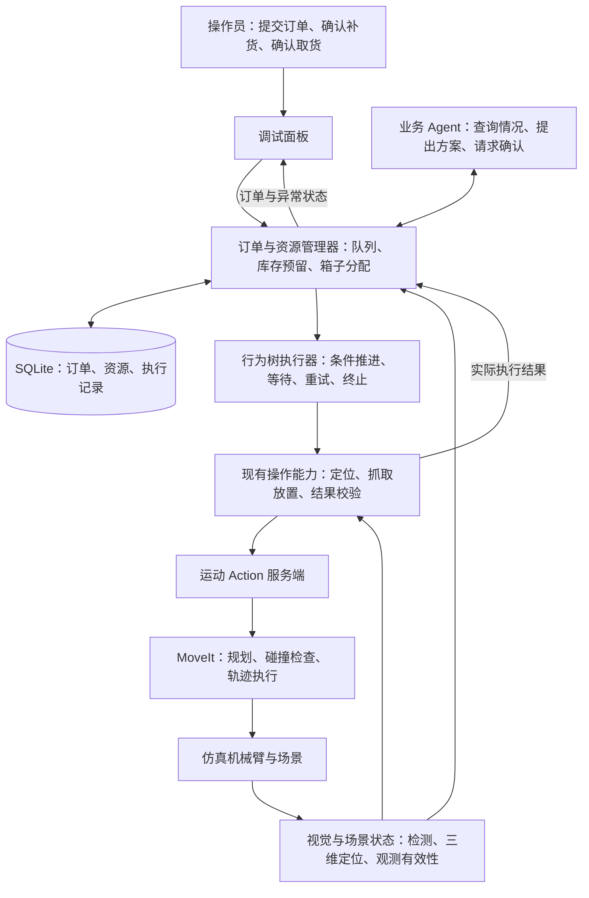

# 有限库存、多订单、可持续运行的智能生鲜配货工作站

> 后续实现更新（2026-10-15）：已按 [数据库统一改造方案](DATABASE_REFACTOR_PLAN.md) 替换订单、库存和箱位的内存账本。
> 本文件保留原阶段设计；当前模块与验收见 [数据库改造交付说明](DATABASE_REFACTOR_DELIVERY_2026-10-15.md)。

整理日期：2026-10-08。

## 文档性质与编号依据

本文以用户重新提供的完整原方案为准，保存完整目标、职责和第 0～7 步。
替代此前错误调整的编号与遗漏，不再以截图缺失为由改写顺序。
这是目标设计，不代表所有功能已实现。已有实现记录用于对照，不改变方案编号。
本次只保存文档，不修改代码、不安装依赖、不启动订单；后续按用户指令逐阶段推进。

## 目标与边界

在现有 ROS 2 + Agent + MoveIt 工作站上建设有限库存、多订单、可持续运行的智能生鲜配货工作站。
重点是 ROS 2 通信与执行、Agent 工具决策、资源调度、行为树、状态持久化与故障恢复，而非增加前端功能。
主要用于学习 ROS 2、Agent 和就业项目实践，不以科研或前端包装为目标。
Agent 使用真实视觉感知及工具完成订单；仿真实体引用仅用于安全验证和场景维护，
不得伪装成视觉观测。用户负责填写验收订单，未经明确授权不自动创建测试订单。

## 最终业务效果

桌面预先散落混合商品，系统通过现有视觉工具观察库存。用户提交订单后：

1. 接收订单，检查库存和空闲箱子。
2. 预留商品，分配收货箱。
3. Agent 根据订单、库存和执行反馈调用受约束的工具推进任务。
4. ROS 执行模块控制抓取、避障、放置并反馈结果。
5. 商品真正装箱后才更新订单进度和库存。
6. 完成一单后保留现场，继续下一单。
7. 缺货、检测失败或运动失败进入明确等待或异常状态。
8. 用户确认取货后，箱位才重新空闲。

业务从一类商品一箱变为一份订单一箱，允许混装；原分类模式保留用于对照与回归测试。

## 总体结构与职责



| 模块 | 负责什么 | 不负责什么 |
| --- | --- | --- |
| Agent | 理解需求、查询状态、提出业务方案、请求人工确认 | 不控制关节，不自行宣布抓取成功 |
| 订单与资源管理器 | 校验订单、预留库存、分配箱子、决定是否允许执行 | 不计算轨迹 |
| 行为树执行器 | 条件执行、等待、有限重试、失败分支 | 不替代账本、不规划路径 |
| 视觉模块 | 类别、位置与观测信息 | 不以一次漏检判定零库存 |
| 操作能力模块 | 单件定位、抓取、放置与验证 | 不决定订单优先级 |
| MoveIt | 轨迹计算、碰撞检查、执行轨迹 | 不理解订单业务 |

固定职责边界，避免 Agent、工作站和行为树重复统筹。

## 第 0 步：固定现有基线与接口设计

整理现有模块、调用链、Git 状态与测试，明确复用与拆分范围。
设计核心对象：Order（内容、优先级、状态、完成数量）、InventoryItem（观测物品、类别、位置、时间、资源状态）、BinResource（位置、占用与订单绑定）。

```text
已接收 → 排队 → 资源已预留 → 执行中 → 配货完成 → 已取货
                     ↘ 等待补货 / 等待人工 / 执行失败
```

配货完成不等于箱子空闲。本阶段产出设计文档、接口草案、基线记录，暂不改变运行效果。

### 已有实现对照

- 区分订单需求、箱位资源、订单分配记录和工作台执行状态。
- 建立 Order / OrderLine、BinResource、OrderAllocation、BinManager 的职责边界。
- 明确执行 COMPLETED 不等于已交付，工作台 READY 不等于所有箱位空闲。
- 使用订单 Action、状态 Topic、取货 Service 和恢复 Service 连接业务与执行。

记录：[第 0、1 步实现](../ros2_ws/src/produce_order_workstation/FULFILLMENT_PHASE01.md)。

## 第 1 步：先让一份订单进入一个箱子

先不同时引入队列与行为树。新增配货模式并保留分类模式，将商品类别到箱子的映射改为订单到箱子的分配。
同单玉米、胡萝卜、苹果、番茄进入同箱；不再完成一单就自动重建桌面；增加明确的确认取货和补货准备入口。
箱内位置采用合理分散的确定性规则，并保留可验证的数量上限，不全部压在同一坐标上。

验收：用户填写混合订单，商品同箱；订单结束后现场保持不变。

知识点：资源建模、配置兼容、ROS 状态反馈、放置目标生成。

### 已有实现与物理修正对照

- 一份混合订单分配一个空闲箱位，各 SKU 放入同一个订单箱。
- 默认配货模式初始不生成收货箱；接单后生成指定箱位的订单箱并同步 PlanningScene。
- 成功装箱后保留商品及箱子，资源状态为 WAITING_PICKUP。
- 人工按订单确认取货；验证并移走该单商品及箱子，移除碰撞模型，成功后释放箱位。
- 动作前失败可在清理成功后释放；动作后失败锁定为 RECOVERY_REQUIRED。
- 有完成订单尚未取货时禁止直接重置场景。

修正记录：[动态订单箱](../ros2_ws/src/produce_order_workstation/DYNAMIC_BOX_SCENE.md)。

## 当前已经存在的补充能力

视觉候选账本 InventoryLedger 已实现观测关联、整单原子预留、搬运/放置状态跟踪，
并发布结构化库存观测消息。它仅保存在内存中，不是可靠物理库存总量，
不得把漏检直接解释为缺货。第 2、3 步已增加业务订单队列；工作台忙时仍拒绝
并发执行 Goal，但 SubmitOrder Service 可以继续登记排队订单。

记录：[视觉候选账本](VISUAL_INVENTORY_LEDGER.md)。

## 第 2 步：建立持续库存与库存预留（已实现，现场验收待操作员）

目的：解决“桌上有多少、还能承诺多少、抓完以后剩多少”。

- 分开记录观测信息、业务状态和不确定状态。
- 观测信息记录视觉最近看到了什么，包括时间戳和坐标系。
- 业务状态区分可用、被预留、正在搬运、已经装箱。
- 长时间未观测、位置关联失败或抓取结果不明时标为不确定。
- 结合多次观测、空间关联和执行记录，不以单帧检测数量作为完整库存。
- 预留流程：确认可用库存 → 订单预留 → 执行抓取 → 验证装箱 → 确认消耗。
- 被预留的商品仍在桌面上，但不能重复承诺给其他订单。

最初 InventoryLedger 只提供视觉候选关联和逐件预留。本次已补充整单原子预留、
状态摘要、同所有者观测关联、候选替换、异常释放和不确定观测处理。
实现及验证说明见 [第 2、3 步记录](FULFILLMENT_PHASE23.md)。视觉候选仍不等于实物盘点保证。

验收：连续处理订单时剩余库存正确变化；视觉暂时漏检不会清空库存；不会重复预留。

知识点：ROS 自定义消息、时间戳、坐标系、状态关联、资源预留与一致性。

## 第 3 步：支持多订单与资源调度（已实现，现场验收待操作员）

在库存可信之后，再允许多个订单进入系统。

- 机械臂仍一次执行一件商品，但允许多个订单排队。
- 每个订单分配自己的箱子。
- 无空闲箱子时排队，不覆盖已装好的订单。
- 库存不足进入等待状态，显示缺少哪些商品。
- 增加优先级，但只在当前物品放好、夹爪退出的安全边界切换订单。

采用确定性调度规则，不让大模型代替简单队列排序。

验收：两份订单不会重复预留同一物品；急单不会打断正在搬运的物品。

知识点：ROS 任务接口设计、并发控制、资源互斥、安全调度边界。

## 第 4 步：把 Agent 提升到业务协作层

2026-10-13实施记录：[第4～7步MCP版本](PHASE47_MCP_DELIVERY.md)。原职责和编号不变。

从目前主要参与检测、抓取、完成，提升为理解完整业务状态。新增受约束工具，例如：

| 工具 | 功能 |
| --- | --- |
| query_orders | 查询排队、执行和异常订单 |
| query_inventory | 查询库存、预留和不确定情况 |
| propose_fulfillment_plan | 提出满足哪些订单、如何推进的方案 |
| request_order_change | 缺货时请求用户确认修改订单 |
| request_replenishment | 请求补货，不自行生成库存 |
| explain_task_status | 根据真实状态解释卡在哪里 |

Agent 方案必须经过管理器校验。工具调用成功、自然语言解释、实际完成是三件不同的事。
缺两个番茄时可建议等待补货或请求确认减少数量，不能自行用苹果替换。

验收：缺货时说明情况并请求确认，不绕过库存检查、不擅自改订单。

知识点：工具调用、结构化参数、权限边界、人工确认、业务决策与执行分离。

## 第 5 步：引入行为树，组织可靠执行

此阶段才引入 BehaviorTree.CPP / BehaviorTree.ROS2，实施前检查 Jazzy 与现有依赖兼容性。
组织固定、可审查的执行树：

```text
检查订单与资源 → 定位当前商品 → 抓取并验证 → 规划运动与放置
→ 验证装箱 → 提交库存与订单进度 → 处理下一件
```

- 每个步骤明确成功、失败和运行中状态。
- 设置有上限的重试与等待分支，不允许无限重试。
- 检测失败、运动失败与缺货进入不同分支，取消请求正确传递。
- 现有运动 Action 继续承担底层运动；MoveIt 继续负责路径规划。
- 行为树负责“下一步是否应该执行”，不接管轨迹计算。

知识点：行为树、Blackboard、异步 ROS Action 客户端、取消与超时、失败分支。
验收：检测失败、运动失败与缺货进入不同分支；取消正确传递；无无限重试。

## 第 6 步：持久化与重启恢复（已实现保守版本）

目的：保存订单需求及状态，避免重启后丢失业务记录。

- 使用 SQLite 保存订单、预留、箱子绑定和执行检查点，明确事务边界。
- 数据持久化不代表物理现场或视觉坐标仍然有效。
- 重启前的执行中订单转为待核对，不自动重放机械臂运动。
- 箱位恢复须核对现场，不能仅凭数据库记录自动接续。
- 过期视觉候选必须重新观测；仿真整体重置须显式区分旧场景记录。
- 尚未执行任务可以恢复排队；已确认装箱物品不得重复计数；可能持物的中断任务须核对。

验收：排队需求可恢复；执行中任务不会重启后重复抓取；现场未核对时禁止自动运动。

知识点：数据库事务、幂等请求、执行检查点、物理状态与业务状态对账。

## 第 7 步：整体验收与项目交付（基础交付完成，完整现场矩阵待验收）

由用户填写订单，验证登记、执行、反馈、待取货、取货释放、排队继续与异常恢复。
界面只增加必要队列与状态显示，不优先进行新一轮视觉包装。
保留自动化单元测试与日志；不宣称未经现场验证的自动恢复或库存保证。
覆盖混合订单同箱、多订单无重复库存承诺、缺货后补货继续、待取货箱不提前复用，
以及检测/运动失败的明确原因和退出方式。
验证重启后无重复装货、重复计数。整理架构图、ROS 通信图、模块说明、运行方法、异常处理说明和演示步骤。
调试界面只展示订单、库存、箱子、执行阶段和 Agent 工具调用，不做复杂前端包装。

## 执行约定

- 用户确认方案后按小阶段执行，每阶段讲清模块、对象、上下游与输入输出。
- 先核对已有实现，避免重复增加库存或通信层。
- 修改和验收完成后统一 Git 提交，不要求每个小改动单独提交。
- 未实现功能必须标为规划中，不展示虚构队列、库存或恢复结果。

## 执行顺序确认

原方案从第 0 步开始，先固定接口和状态规则，不一次塞入队列、Agent、行为树和数据库。
当前第 0、1 步已有实现记录；第 2、3 步已按用户指令改良并进入验证/交接，不重复实施已有功能。
第 4 步起仍须等待用户指令，不能自动扩展到业务 Agent、行为树或数据库。
每阶段：说明痛点与范围 → 修改并测试 → 用户填写订单观察 → 模块化对比讲解 → 阶段完成后一次 Git 提交。
本文依用户提供原方案整理格式，移除了粘贴时重复插入的“视觉观测”文字，不改变原方案的业务目标、步骤编号或职责边界。
