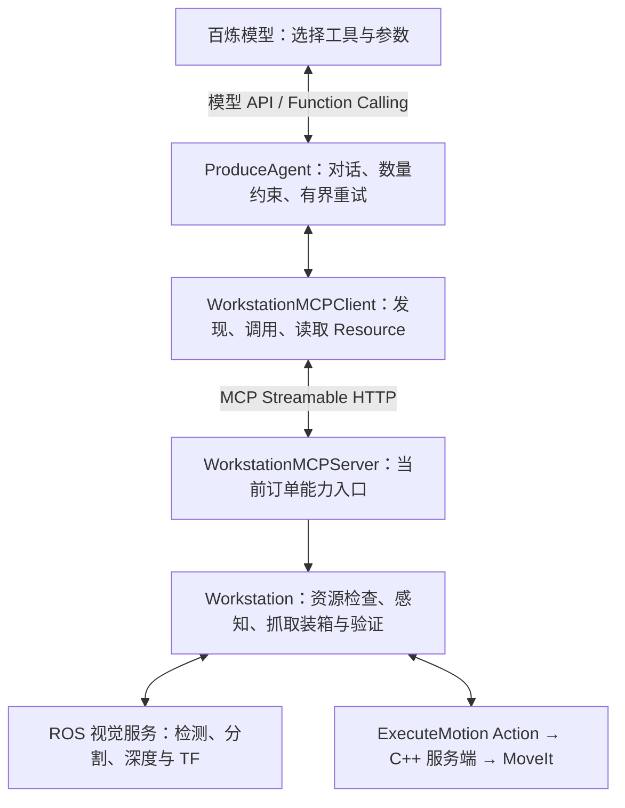

# MCP 接入：工作站工具边界（2026-10-11）

## 1. 本次范围

在第 0～3 步及原有视觉修复版本上接入真实 MCP，不恢复暂存的第 4～7 步。
订单仍由现有服务接收、排队、预留库存和分配箱子。视觉模型、桌面布局、
MoveIt 规划、ExecuteOrder / ExecuteMotion Action 均未因本次改动而替换。

以前 Agent 的 `_invoke_tool()` 直接访问 `self.workstation` 的三个 Python 方法。
现在它调用 MCP Client，经过真实的本机 HTTP / JSON-RPC 请求，由 MCP Server
调用这些方法。没有 MCP 不可用时的直接调用回退，否则故障会被掩盖。



## 2. 三个对象的上下游、成员与功能

代码目录：`ros2_ws/src/produce_order_workstation/produce_order_workstation/`。

### ProduceAgent（原有类，修改 agent.py）

- 上游：当前获准执行的订单及百炼的 `tool_calls`。
- 新成员 `tool_client`：当前订单的 MCP 客户端。
- 删除 Agent 中手写的 `TOOLS` 常量；`tools/list` 返回的描述与 JSON Schema
  转换为模型 API 的 function tools。模型仍通过 Function Calling 选择工具。
- `run()`：宿主创建订单作用域服务端和客户端，记录 `MCP_CONNECTED`，
  运行原有循环；退出时先关闭客户端，再关闭服务端。
- `_run_loop()`：原有对话循环，数量约束、五次空检测停止、候选拒绝和
  重新感知策略保留；不是行为树，也不是新增的业务 Agent。
- `_invoke_tool(name, arguments)`：只调用客户端，不再硬编码工作站方法。
- `_remaining()`：通过 MCP Resource 读取已经完成的数量；候选拒绝后可用
  ID 同样从 Resource 读取，不再直接读取工作站私有候选表。
- 下游：MCP 客户端；执行结果再作为 `role=tool` 反馈给百炼。

注意：本次只是工具/状态读取边界解耦，宿主仍持有 Workstation 来管理
配置、日志、取消和服务生命周期，不能称为完全独立的 Agent 进程。

### WorkstationMCPClient（新增 mcp_client.py）

- 上游：Agent 的工具名称与参数。
- 输入：本机 URL、宿主生成的临时 token、请求超时。
- `_serve()`：专用线程中的异步任务，持有官方 SDK `ClientSession`，
  执行初始化、`tools/list`，随后按队列顺序处理调用。
- `tools`：供模型使用的工具描述；`_schemas`：参数校验用 JSON Schema。
- `call()`：检查工具名、类型、必需字段和多余字段，发送 `tools/call`，
  解包结果；恢复 `PerceptionMismatch` 的 code/reobserve，以及取消、暂停等异常。
- `context()`：通过 `resources/read` 读取当前订单状态。
- `_request()`：将同步 Agent 请求转交给异步线程，通过 Future 等待结果。
- `close()`：排在已提交请求之后退出并清理会话；不会自动重试物理动作。
- 下游：官方 MCP HTTP 客户端；输出是原有工作站结果字典或原有异常。

### WorkstationMCPServer（新增 mcp_server.py）

- 上游：经过本机能力 token 检查的 MCP 请求。
- 输入：宿主绑定的 Workstation 与 Order。模型参数中没有 order_id、箱位
  或任意运动坐标，因此不能用工具参数切换订单或绕过放置规则。
- `mcp`：官方 SDK 的 FastMCP 服务对象，登记三个工具和一个 Resource。
- `_lease`：工具执行互斥锁；另一个客户端在工具运行期间请求操作会被拒绝。
- `_perceived`：服务端的新鲜候选流程标志；即使独立客户端绕过 Agent，
  也必须先感知；成功放置后须再次感知。
- `_execute()`：检查取消与订单需求，调用原有工作站方法，记录 MCP 事件，
  将结果或领域异常编码为结构化返回值。
- `_LocalTokenGuard`：本机临时能力校验，不是完整 OAuth 服务；token 不写日志、
  不发给模型、不使用百炼 API Key。HTTP 仅监听 127.0.0.1 随机端口。
- `close()`：拒绝新操作，等待正在执行的工具退出，再关闭 HTTP 服务。
- 下游：原有 Workstation，继续经 ROS 服务与运动 Action 工作。

服务端随获准执行的订单创建，订单结束/暂停/失败后销毁；未排到的订单
不会各自启动机械臂工具服务。多个订单仍由现有调度器串行进入工作站。

## 3. 接口输入输出

| MCP 能力 | 输入 | 输出/作用 |
|---|---|---|
| `get_object_positions` | `sku: string` | 原有 RGB-D 检测候选、detection_id、三维坐标和过滤诊断 |
| `pick_and_place` | `detection_id: string` | 原有抓取、放置、物理验证结果；成功才更新计数 |
| `finish_order` | 空对象 | 原有数量与物理装箱审核，成功为 status=verified |
| Resource `workstation://order/context` | 固定 URI | order_id、mode、completed、candidate_ids；只读 |

服务端结构化载荷为 `{"result": 原有结果}` 或 `{"error": 异常信息}`。
客户端解包后再交给 Agent，因此模型获得的业务结果结构保持不变。
不能把成功收到 HTTP 响应当成抓取成功，也不能让模型自行增加库存计数。

## 4. 安全与局限

- 保留库存预留、候选新鲜度、仿真安全校验、碰撞规划及装箱验证。
- 仿真实体信息仍用于原有安全/物理验证，不是 MCP 新增的视觉定位来源。
- HTTP 失败/超时不代表机器人停止。不会自动重发抓取；关闭流程会等待底层
  工具退出，防止旧动作未结束就执行下一单。
- 当前仍是同步完成一个工具后返回，不新增任务状态/取消工具，也未实现 MCP
  长任务扩展。取消仍走现有订单 → Workstation → ROS Action 链路。
- 底层若永久阻塞，安全排空也可能等待；MCP 不解决 MoveIt 的底层硬超时。
- 服务端是嵌入式、临时、订单限定的本机服务，不是公开部署的多租户网关。
  将来独立部署需要增加 ROS 侧任务接口、授权、幂等和更完整的任务句柄。
- 不会提高检测精度；启动方式和现有操作面板不变，不新增复杂前端。

## 5. 安装在哪里、如何运行

沿用 Conda 环境 `/home/wang/miniconda3/envs/rai-jazzy`，未新增环境或 Docker。
固定 `mcp==1.30.0`（官方 SDK 1.x 维护线），避免安装时意外切换不兼容的 2.x。
新增包：mcp 1.30.0、uvicorn 0.54.0、starlette 1.7.0、sse-starlette 3.5.0、
python-multipart 0.0.32、PyJWT 2.15.1。下载的 wheel 合计约 0.48 MB；
现有 httpx、anyio、pydantic、jsonschema 等依赖复用。

- MCP SDK：协议客户端与服务端。
- Uvicorn / Starlette：本机异步 HTTP 服务。
- 其余包：SDK 的流式 HTTP、请求解析与授权相关依赖；本项目没有因此开放公网。

包的 `setup.py` 已声明 MCP 依赖。正常仍使用原来的 start_workstation.sh 和
start_debug_panel.sh；不用另开 MCP 终端，不用下载新视觉模型。
在界面技术日志/订单报告中查看 `MCP_CONNECTED`、`MCP_TOOL_CALL`、
`MCP_TOOL_RESULT`，结合原有 `AGENT_TOOL_*`、`MOTION_STAGE` 判断调用到哪一层。

## 6. 验证方法

新增 `test/test_mcp_tools.py` 用真实 TCP/HTTP/MCP、替身工作站测试：
发现三工具、Resource 读取、完整调用、非法参数、订单绑定、新鲜感知、
领域异常、token 拒绝、并发互斥、连接清理和超时不重试/不提前释放执行权。
现有 Agent 测试也经过真实 MCP 传输，模型与机器人保持替身，不消耗 API 额度。

测试时需要按项目启动说明加载 Jazzy、Conda 和工作空间。仓库的全局 pytest
默认忽略 src，ROS 自动测试插件还会导入 Qt 测试，因此局部验证使用：

```bash
PYTEST_DISABLE_PLUGIN_AUTOLOAD=1 python -m pytest -c /dev/null \
  -o cache_dir=/tmp/produce-mcp-pytest -q \
  /home/wang/rai_embodied_project/src/examples/rai-manipulation-demo/ros2_ws/src/produce_order_workstation/test/test_mcp_tools.py
```

隔离 DDS 的原有订单调度集成测试用 ROS_DOMAIN_ID=71，不连接实际仿真。
新增 `test_mcp_ros_integration.py` 还验证 Agent → 真实 MCP HTTP → ROS 感知
服务 → 原有 Workstation.move → 真实 ExecuteMotion Action 的连接，以及
grab/lift/place/retreat 四个目标及反馈。模型、感知结果与机器人执行器是替身。
本次协议测试不能替代真实视觉模型 + 百炼 + 仿真装箱验收；没有宣称漏检已解决。

### 本次实际检查记录

- 工作站非 GUI 回归：181 项通过，包含 16 项 MCP 专项测试。
- 系统 Python / PyQt5 界面回归：46 项通过。
- 隔离 DDS 71 的订单队列与 MCP→ROS 集成：各 1 项通过。
- 两个包 `produce_order_interfaces`、`produce_order_workstation` 重建成功。
- `pip check`：依赖无冲突。启动脚本 `bash -n` 检查通过。
- 未启动用户仿真、未提交用户订单、未调用收费模型；不能据此宣称真实抓取验收完成。

真实 ROS 集成检查发现：回退第 4～7 步后，接口生成的旧 C 扩展仍引用
RunFulfillment，导致加载当前消息时出现 undefined symbol。旧接口 build/install
已移到 `/home/wang/rai_phase47_backup/interface-artifacts-before-mcp-06iOvu/`，
然后重新生成当前第 0～3 步的接口，未修改接口源码。第 4～7 步的 stash 和
备份分支继续保留，未恢复其功能；原有布局与 launch 两项未提交更改也保留。

官方参考：https://github.com/modelcontextprotocol/python-sdk/tree/v1.30.0 。
