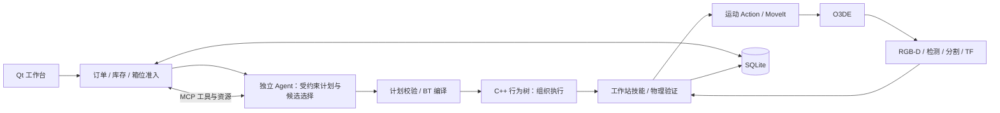

# 运行与故障处理指南

[返回项目首页](../README.md)。首次安装请先阅读 [安装与环境配置](INSTALL.md)。

## 1. 启动前：先检查，不要重复点启动

本机在**已登录图形桌面的终端**运行，路径不依赖终端当前所在目录：

```bash
bash "$HOME/rai_embodied_project/src/examples/rai-manipulation-demo/start.sh" doctor
```

或者进入自己实际克隆的项目根目录，后续统一使用：

```bash
bash start.sh doctor
```

`doctor` 检查 Jazzy、两个构建 overlay、Conda SDK、Qt、动态库、仿真资源、视觉缓存和私有 Key 文件，不启动仿真、不提交订单、不调用计费模型 API。看到 `[FAIL]` 就按该行提示处理，不要继续启动。

机器配置放在 `~/.config/produce_order_workstation/launch.env`，模板是 [config/launch.env.example](../config/launch.env.example)。本机已准备此文件，并保留现有业务数据库；**doctor 输出的 PRODUCE_STATE_DB 才是本次选择的数据库**，不要假设它总是默认库。

## 2. 启动整个项目

```bash
bash start.sh start
```

本机从任意目录可直接运行：

```bash
bash "$HOME/rai_embodied_project/src/examples/rai-manipulation-demo/start.sh" start
```

脚本自动准备环境，启动 O3DE、MoveIt、视觉服务、独立 Agent、C++ 行为树、订单服务和 Qt 工作台；不要求在终端提前激活 Conda。

**不要同时再手动启动 GameLauncher、MoveIt 或 order_server。** 重复 `start` 不会创建第二套。后台启动后关闭启动终端不会停止项目。

启动命令最多等待 240 秒，期间会打印业务状态；它不再只凭 `systemd active` 就说成功：

| 结果 | 意味着什么 | 下一步 |
|---|---|---|
| `[就绪]`，界面为“就绪” | 时钟、关键 Action、视觉服务和工作台状态有效 | 开始第 3 节 |
| INITIALIZING / SCANNING | 正在加载或进行初始化视觉验收 | 等待，不重复启动/提交 |
| `[需处理]`，退出码 2 | 服务上线，但业务要求恢复或库存处理 | 按第 5 节，不当作启动程序崩溃 |
| `[未就绪]`，退出码 1 | 超过等待上限，或关键接口/时钟没有准备好 | 运行 `logs-once` 查看原因；后台不会因超时被强制删除 |

**窗口出现 ≠ 库存通过；就绪 ≠ 模型账户有额度。** Agent 在接单后才真正调用模型，doctor 不会消耗额度验证。

## 3. 完成第一份订单

1. 看顶部工作台状态，等待“就绪”。桌面初始预置混合商品；空闲箱位不代表已经有四个空箱。
2. 在“新建订单”填写数量。不需要的商品填 **0**；当前每单合计上限 **8 件**，不是每类都可以各填 8。
3. 保留自动生成的唯一订单号，选择优先级（数值越大越优先），点击 **提交订单** 一次。
4. 查看“已登记”回执和当前订单队列。**已登记不等于立即执行**：库存/箱位不足会等待；正在执行另一单时，新订单仍可登记。
5. 执行时观察最近任务、商品进度和箱位。Agent 选择受约束计划及视觉候选，行为树组织执行，MoveIt 规划机械臂运动。
6. 显示“等待取货”后，在“订单箱位”下方的下拉框选择对应订单，点击 **确认取货**。仿真会移走该订单的箱子和商品，释放箱位；不要在尚未完成时把它当作强制清理按钮。
7. 等待取货后的库存复查结束，再继续操作。遇到“工作台忙”看状态等待，不连续点击。

同一订单的玉米、胡萝卜、苹果、番茄放入**同一个订单箱**。完成配货不自动移走箱子，也不自动重建整个桌面。

## 4. 连续订单、库存和常用按键

队列显示当前任务，不混排普通历史已结束记录；历史到“订单记录”查看。执行任务置顶，等待任务按优先级降序、同级按登记序号先来先服务。缺货/缺箱可跳过等待，**等待顺位不是无条件执行顺序**，也不会在夹着商品时切换订单。

| 按键 / 区域 | 什么时候用 | 结果与注意事项 |
|---|---|---|
| 提交订单 | 数量合法、服务同步时 | 登记需求，观察回执；不要重复创建相同需求 |
| 换订单号 | 准备另一份新需求时 | 只更换草稿编号，不重试失败订单、不取消旧单 |
| 最近任务 → 取消 | 当前订单执行中 | 请求安全取消，等待结果；不是急停，不能推断机械臂立即停止 |
| 取消选中排队单 | 先选中未执行等待单 | 只取消这单；选中安全暂停单时文字变为“丢弃暂停订单…”并要求确认 |
| 清除待执行队列 | 不再需要等待中的需求 | 保留执行中、已部分装箱和待取货订单，不清空数据库 |
| 视觉复查 | 观测不足、暂停后需要重新确认 | 保留原需求和进度，重新检查可用观测；不是生成商品 |
| 补货准备 | 确认需要补货，且工作台空闲、按钮可用 | 替换桌面剩余货源，保留订单箱和已装进度；之后等待视觉复查 |
| 确认取货 | 订单真正 WAITING_PICKUP | 移走对应箱与商品，释放箱位 |
| 清空日志 | 只想清理显示内容 | 不修复故障、不停止任务、不清除数据库审计 |
| 清除已结束记录 / 恢复显示 | 整理历史界面 | 隐藏/恢复显示，不删除业务真相；活动资源受保护 |
| 诊断与帮助 | 状态异常，不清楚下一步 | 检查相机数据、处理指南、技术日志、恢复/重置入口 |
| 业务协作 → 查状态 | 想查看业务事实，不想调用模型 | 直接查询真实状态；“询问 Agent”才会调用模型 |

**这里没有“暂停全部调度”按钮。** 关闭测试脚本或关闭 Qt 都不等于停止后台工作站；已登记订单仍可能被调度。确实要停机按第 7 节，不用清空日志代替停止。

## 5. 出问题时，按状态处理

| 现象 / 状态 | 推荐的操作顺序 | 不应该做什么 |
|---|---|---|
| 等待库存 / No selectable ... | 诊断与帮助 → 检查相机数据 → 视觉复查；确认实际缺货后再补货准备 | 不把漏检直接等同缺货，不重复下单 |
| 库存复查失败 / 超时 | 先检查三路相机消息；有消息再复查；仍失败查看技术日志 | 不连续补货掩盖相机或模型服务故障 |
| 等待箱位 | 选择已完成订单 → 确认取货 → 等待释放 | 不取消已装好的订单来制造空箱 |
| 暂停、已有装箱进度 | 核对现场 → 视觉复查，等待原单重新准入；确实放弃才选中它并确认丢弃 | 不重新提交完整数量，否则可能形成两单 |
| 本单 FAILED，但工作台就绪 | 看订单原因与技术日志；排除原因后，如需重做用新订单号 | FAILED 不会自动变成功；不要无条件重复机械动作 |
| 需要恢复 / 运动结果未知 | 先核对夹爪与箱；处理待取货/安全暂停单；再用恢复入口并阅读清理确认 | 不把取消、超时当“没有发生运动”的证据 |
| 重启后提示历史现场待核对 | 按下面的“重启现场核对”完整流程 | 不删除数据库来绕过历史任务 |
| 模型 HTTP 401/403/429、额度不可用 | 核对账户、地区、型号和额度；修改外部模型配置后安全重启 | 复查/补货按钮不能解决 API 鉴权和额度问题 |
| 服务离线、仿真已退出 | `bash start.sh logs-once` → 记录错误 → 安全重启；有旧任务按核对流程 | 不在后台失联时反复提交 |
| 按键灰色 | 检查状态是否同步、是否选中订单、是否正扫描/执行、是否满足安全条件 | 灰色不是让你从终端绕过检查 |

### 重启现场核对：需要确认的地方在哪里？

1. 先等待启动阶段的自动检查点恢复。恢复成功会继续显示原订单进度；**不要立即又提交相同需求**。
2. 如果仍显示“历史现场待核对 / 需要恢复”，在底部 **业务协作** 页签点击 **现场核对…**。
3. 请求列表出现“核对并重建旧现场”后，**选中这一行**，再点击列表下方 **确认**。
4. 阅读弹窗，确实同意丢弃未核对旧现场并重建，才点击 **Yes / 是**。只点“现场核对…”不会直接重置；只输入“确认”文本也不等于批准。
5. 等待请求状态变为“执行中 → 已完成”，工作台重新扫描并就绪。如果显示“未启动，可重试”，先处理提示的忙状态或安全条件，再选中请求确认。

重建会清理旧物理现场；旧订单保留历史但不算交付。普通运行中的失败恢复，使用“最近任务”的 **恢复工作台…** 或“诊断与帮助 → 恢复 / 重置工作台…”，同样须先处理保留资源。**恢复是破坏现场的维护，不是无损重试。**

## 6. 窗口、状态与日志

```bash
bash start.sh panel       # 仅重开订单界面；不会重复启动整个仿真
bash start.sh status      # 系统服务状态 + 有上限的 ROS 健康检查
bash start.sh ready       # 只检查业务/通信就绪，不下单
bash start.sh logs-once   # 最近日志，打印后退出
bash start.sh logs        # 持续看日志；Ctrl+C 只退出看日志
```

`panel` 打开后仍离线，说明不是“再开一次窗口”就能修复后台。启动配置或代码更新后，`start` 不会替换已经运行的进程，需要安全 `restart` 才加载新配置。

本地数据：

- 启动配置：`~/.config/produce_order_workstation/launch.env`。
- API Key：`~/.config/rai/bailian.env`，权限 600，不显示、不提交。
- 订单数据库：以 doctor 的 `PRODUCE_STATE_DB` 为准，默认 `~/.local/share/produce_order_workstation/workcell-mcp.sqlite3`；本机可能明确选择历史验证库。
- 订单报告与感知诊断：`~/.local/share/produce_order_workstation/reports/`、`perception/`。
- 进程日志：用户级 journal；数据库记录才是业务依据，清空界面显示不会删库。

## 7. 正常停机与重启

先不要再提交新单，取消不需要的未执行排队单；如有当前动作，点击“取消”并等待安全结果。已完成订单先确认取货；暂停或状态不明订单先核对。

```bash
bash start.sh stop
bash start.sh start
# 或安全处理现场后：
bash start.sh restart
```

`stop` 停止工作站、界面及相关测试控制器，**不删除数据库，也不把未完成订单当成完成**。紧急关闭仿真/进程可能留下待核对状态，下一次必须走恢复流程。

## 8. 模块与源码学习



Agent 不直接生成关节轨迹或自行确认装箱；行为树不代替库存账本；MoveIt 不理解订单。

- 业务与持久化：`ros2_ws/src/produce_order_workstation/produce_order_workstation/`。
- 自定义 ROS 接口：`ros2_ws/src/produce_order_interfaces/`。
- 行为树执行：`ros2_ws/src/produce_order_bt/`。
- 机械运动：`ros2_ws/src/robotic_manipulation/`。
- 仿真素材：`Project/`；RAI 外部兼容修改：[patches/README.md](../patches/README.md)。
- 学习与阶段边界：[阶段评估](PROJECT_CHECKPOINT_AND_QUEUE_FIX_2026-10-21.md)。旧 docs 包含历史方案，涉及已重构对象时以当前源码为准。

## 许可与验证范围

保留上游 Apache-2.0 [LICENSE.txt](../LICENSE.txt) 及素材 NOTICE；本项目不是将上游框架全部声明为原创。模拟器和模型从其原始渠道准备，不放进 Git。

最后一批固定压力测试只完成前三轮完整核验，第四轮因玉米候选不可选退出；不能把后续数据库数量增加算成五轮通过。原生崩溃根因仍开放。轻量 CI 仅验证脚本/审计/启动器契约，**不代表真实 ROS 仿真端到端验收**。
