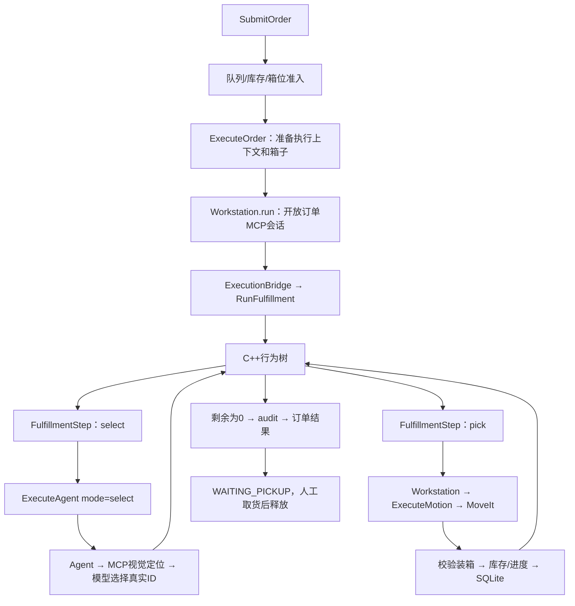

# 第4～7步：MCP版本实施与交付

日期：2026-10-13；基线：`9922c9d`。依据原 FULFILLMENT_ROADMAP，不重新编号。
旧第4～7步stash与备份分支保留。本轮复用其独立模块，重新适配常驻Agent/MCP边界。

## 阶段与范围

| 阶段 | 实现 | 边界 |
|---|---|---|
| 4 | 六个业务MCP工具、ExecuteBusiness、人工确认请求 | 模型不能审批自己的建议，不直接改库存或移动机械臂 |
| 5 | 独立C++ BehaviorTree.CPP、异步ROS步骤接口、有限重试、取消排空 | 粗粒度技能树，运动与物理验证仍复用Workstation/MoveIt |
| 6 | SQLite快照、意图/结果、审批和事件；幂等登记；启动隔离 | 保守恢复，不自动重放动作，不承诺带物续作 |
| 7 | 回归/隔离ROS/界面/基础真实仿真验收、文档与启动方式 | 未覆盖所有SKU及完整现场故障矩阵，不宣称视觉问题解决 |

## 对象归属

```text
订单进程 OrderActionServer
├── queue: OrderQueue                        第3步
├── bin_manager: BinManager                  第1步
├── workstation: Workstation
│   ├── inventory: InventoryLedger           第2步
│   ├── execution_runner → ExecutionBridge.run
│   └── durable_event_sink → WorkcellStore.event
├── store: WorkcellStore                     第6步
├── business: BusinessCoordinator            确定性规则/操作员审批
├── _business_gateway: BusinessMCPServer      六个业务工具
├── _mcp_gateway: WorkstationMCPServer        当前订单感知/兼容工具
├── _execution_bridge: ExecutionBridge       步骤准入、顺序与去重
└── _agent_dispatcher: AgentDispatcher        请求独立Agent选候选

Agent进程 ProduceAgentService
├── ExecuteAgent → ProduceAgent.select_candidate()/run()
└── ExecuteBusiness → run_business_agent()

C++进程 produce_order_bt_executor
└── RunFulfillment → Item/Audit树
```

Agent不导入或持有Workstation、队列、箱位或SQLite对象。
BusinessCoordinator拥有管理器引用，但不是模型Agent；它是确定性业务规则层。

## 订单完整调用链



Item是RetryUntilSuccessful(Sequence(select,pick))，Audit负责最终校验。
Blackboard存储重试次数，Session保存当前候选、剩余数量和步骤序号。
异步节点onStart发请求、onRunning检查Future并返回RUNNING/SUCCESS/FAILURE，onHalted停止等待。
停止等待不等于机器人停止：Python桥接层撤销会话并等待在途技能排空。
空候选/安全拒绝有限重试；结果不明、取消、暂停进入终态，不重复物理动作。
缺库存/箱位的等待仍在队列，不重复建立BT库存调度器。
select_candidate是Agent内部纯选择Function Calling Schema，不是MCP机械动作工具。
感知仍经MCP进入原RGB-D/分割/深度/TF链；仿真状态仅保留原安全和物理验证用途。
默认backend=behavior_tree；旧run循环仅为显式兼容后端，不会在BT失败时自动回退。

## 业务协作调用链

```text
面板/CLI → BusinessCommand(ask)
 → BusinessCoordinator.ask（只派发，不调用模型）
 → ExecuteBusiness → 独立Agent进程
 → 业务MCP六个工具 → 管理器校验/查询/生成待确认请求
 → 回答、真实上下文和工具轨迹

操作员确认/拒绝 → BusinessCommand(approve_request/reject_request)
 → 校验订单版本/状态、请求有效期及进程 → 事务保存/原维护接口
```

六工具：query_orders、query_inventory、propose_fulfillment_plan、request_order_change、request_replenishment、explain_task_status。
业务MCP另有workstation://business/status只读Resource，与运动MCP使用独立凭据。
不暴露审批、重置、直接改优先级或机械运动；重复未过期建议返回原请求。
Agent先读取工作台事实。空队列不是READY，空观测不是确认缺货，自然语言不是执行成功证据。

## ROS接口

| 接口 | 输入 | 输出 |
|---|---|---|
| ExecuteAgent | 订单、MCP地址/凭据、mode | select返回视觉ID；run保留原决策循环 |
| ExecuteBusiness | 问题、业务MCP地址/凭据 | 回答/工具轨迹或错误 |
| RunFulfillment | session_id、max_attempts | 订单级执行结果、阶段反馈 |
| FulfillmentStep | session_id、sequence、command、ID | 状态、原因、剩余数量、候选ID |
| BusinessCommand | command、arguments_json | 查询、请求或人工审批结果 |

共有五种Action：ExecuteOrder、ExecuteAgent、ExecuteBusiness、RunFulfillment、ExecuteMotion。
ROS仍要求可信本机DDS，没有声称SROS2/公网认证。MCP仅监听127.0.0.1，凭据不进入模型提示词。

## 数据保存与恢复

默认新数据库：~/.local/share/produce_order_workstation/workcell-mcp.sqlite3。
旧workcell.sqlite3不删除、不自动导入；可通过PRODUCE_STATE_DB指定独立数据库。
表：snapshots、operations、requests、events。WAL、synchronous=FULL、短事务。
同订单号同内容/优先级重复登记返回原状态；同号不同内容拒绝。
动作前写INTENT，确认后写VERIFIED，结果不明写UNCERTAIN；同操作ID不能重做。
相同会话步骤重复请求返回缓存，不再次移动机器人。

重启规则：

- 未开始需求恢复排队，重新感知与资源准入。
- RUNNING/PAUSED/WAITING_PICKUP及未释放物理箱位进入RECOVERY_REQUIRED。
- 已确认数量保留，不把数据库当作现场仍存在的证明。
- 旧视觉坐标不恢复成AVAILABLE/RESERVED；旧进程审批请求不能直接批准。
- 当前人工恢复是“核对旧现场”请求、明确RESET_SCENE确认后丢弃旧现场并重建；旧订单历史保留，不算已交付。
- /clock曾正常出现后中断超过15秒进入SCENE_OFFLINE，禁止继续派发。

这是保守恢复，不是断电后自动继续夹持或重建原仿真实体。

## 验证证据与边界

- 三个包构建成功：produce_order_interfaces、produce_order_workstation、produce_order_bt。
- 后端229通过、8条件跳过；隔离DDS域71集成7通过；原生Qt39通过。
- 隔离测试覆盖空检测上限、失败、暂停、取消、顺序去重、两件订单、独立Agent/MCP/ROS通信；模型、视觉、机器人是替身。
- SQLite恢复与审批测试覆盖意图落盘、禁止重复执行、事务回滚、订单/箱位隔离、过期进程请求和建议不自动生效。
- 实际百炼业务问答已完成查询；补充初始化/空观测上下文约束，不把模型措辞当事实来源。
- 实际O3DE胡萝卜1件COMPLETED 1/1；胡萝卜2件COMPLETED 2/2，分别使用visual_carrot_1_1、visual_carrot_2_1，均有抓取与装箱校验。

报告位于~/.local/share/produce_order_workstation/reports/：
agent-live-20261013-222325-787773.json、agent-live-20261013-222825-342235.json。
两份测试订单已经通过ConfirmPickup移走测试箱/商品，四个箱位恢复FREE；报告及取货收据保留。
完整服务重启后，两份订单仍为COLLECTED并保留1/1、2/2历史数量，操作表仍只有三个VERIFIED记录，没有重放。
真实混合SKU、补货续单和现场故障中断仍建议操作员逐项验收；本轮没有更换视觉模型。

## 使用和重复验证

启动仍用start_workstation.sh和start_debug_panel.sh；前者新增BT、业务MCP和SQLite。
面板“业务协作”支持提问、确认/拒绝建议、核对旧现场。
加载ROS环境后：

```bash
ros2 run produce_order_workstation business_cli query_orders
ros2 run produce_order_workstation business_cli ask '{"question":"为什么订单等待？只查询，不修改。"}'
bash /home/wang/rai_embodied_project/src/examples/rai-manipulation-demo/ros2_ws/src/produce_order_workstation/scripts/check_phase47.sh
bash /home/wang/rai_embodied_project/src/examples/rai-manipulation-demo/ros2_ws/src/produce_order_workstation/scripts/check_phase47.sh integration
```

integration强制隔离域71，不触碰域0工作站。
内存紧张可先start_workstation.sh enable_perception:=false，仿真相机就绪后运行start_perception.sh；不要重复启动视觉。
复用现有Conda和本地BT依赖，没有下载大型包或更改系统ROS。

技术依据：[BT异步节点](https://www.behaviortree.dev/docs/guides/asynchronous_nodes/)、[SQLite WAL](https://www.sqlite.org/wal.html)、[SQLite同步设置](https://www.sqlite.org/pragma.html)。
